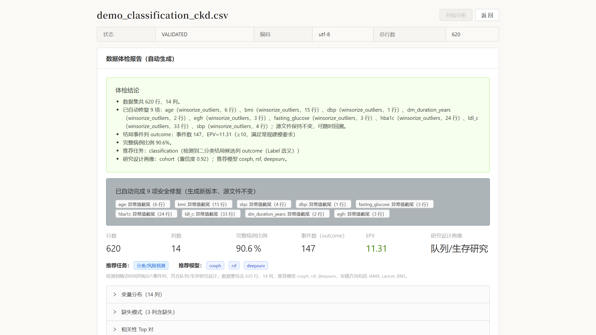
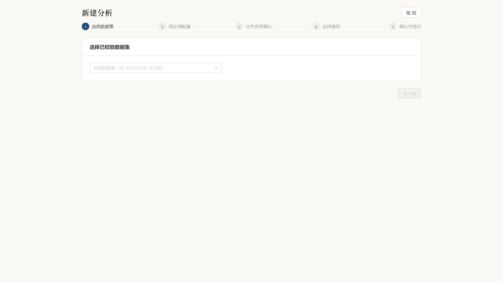
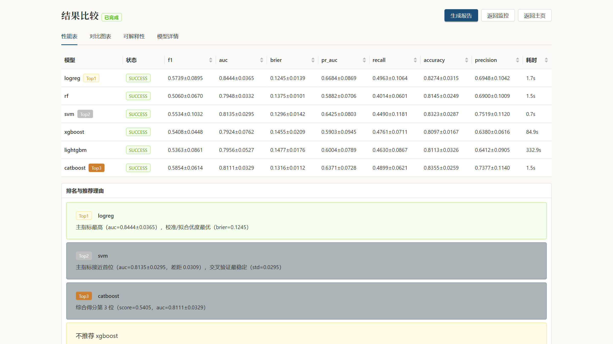
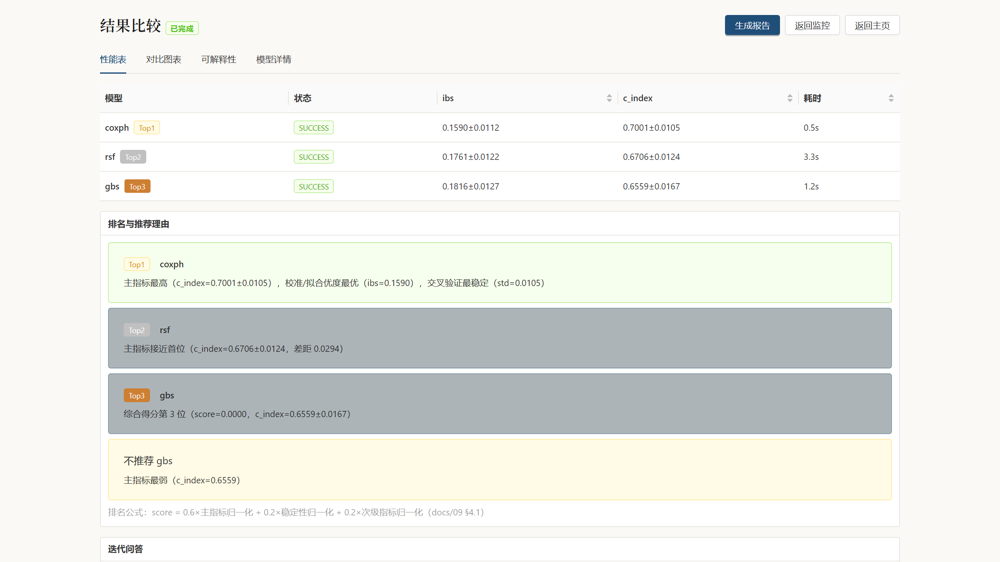
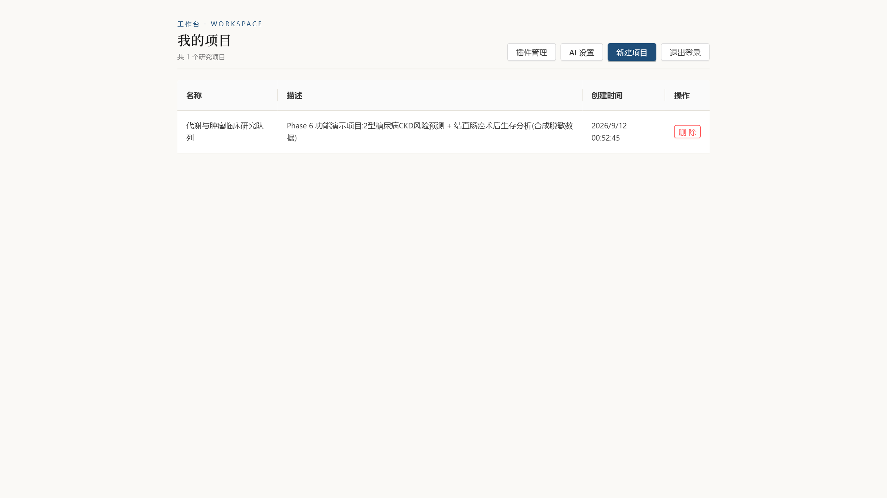
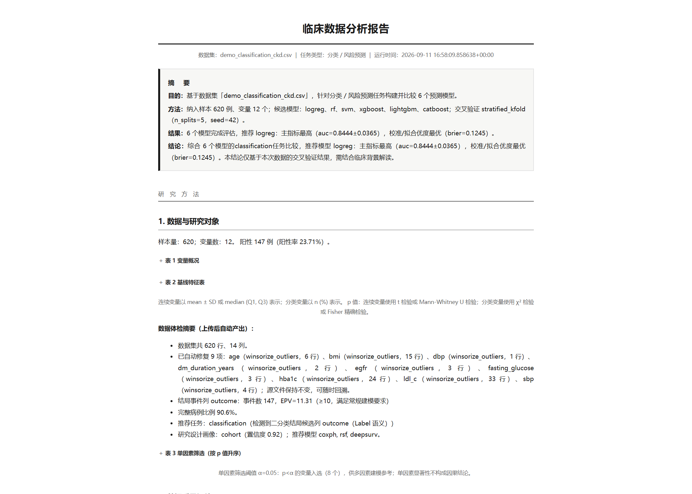

# Clinical Data Analysis Platform (CDAP)

[English](README.md) | [简体中文](README.zh-CN.md)

CDAP turns de-identified clinical CSV/Excel files into validated datasets, configurable preprocessing pipelines, task-specific multi-model analyses, model comparisons, and clinical analysis reports (PDF / HTML / Word / Markdown).

**Built for clinicians and medical researchers who do not program:** the full workflow is available through a web interface.

## What CDAP helps you do

- Turn follow-up records and laboratory indicators into statistical analysis results: which factors are associated with an outcome, which predictive model performs best, and how large each factor's effect is.
- Run three common clinical research tasks:
  - **Classification** (for example, recurrence, complications, or benign/malignant status)
  - **Regression** (for example, length of stay or a numeric indicator)
  - **Survival analysis** (including Kaplan-Meier curves, Cox regression, and random survival forests)
- Generate chart-rich analysis reports in one click. PDF can be archived, Word can be edited, and HTML can be viewed online.

## Features

| Feature | Description |
|---|---|
| **No programming** | Complete the workflow in the browser: upload data → confirm the task → select models → review results → download a report |
| **Data stays on premises** | Deploy on an internal hospital server and run entirely inside the local network; no external cloud service is required |
| **No required API key** | Statistics and modeling run locally and work offline by default. Optional local Ollama assistance also keeps data on premises; when unavailable, deterministic rule templates are used automatically |
| **Guided data quality workflow** | Upload generates an automated data health report. Missing, invalid, and abnormal data can be repaired in one click where safe. Task types are detected with reasons and model recommendations |
| **Methodological guardrails** | Detect target leakage, proxy variables, duplicate patients, and other risks. Blocking issues trigger an integrity gate; continuing requires explicit confirmation and produces a prominent exploratory-mode warning |
| **Multi-model comparison** | Compare 20+ established models, including logistic regression, random forest, SVM, XGBoost, LightGBM, CatBoost, Lasso, Cox models, random survival forests, DeepSurv, GAM, and GEE |
| **Traceable results** | Metrics are computed through cross-validation. Recommendations cite only real computed values. Multiple comparisons are corrected, and reports include methods, limitations, and a disclaimer |
| **Explainability** | Feature importance and SHAP visualizations show which variables drive model decisions |
| **Access control and audit** | Admin/researcher/viewer roles, project-level isolation, and audit records for critical operations |

## Languages and internationalization

- The web interface supports **Simplified Chinese (`zh-CN`) and English (`en`)**.
- On first visit, CDAP detects `localStorage → browser language`; unknown languages fall back to Simplified Chinese.
- A manual language selection is persisted as `cdap.locale` and restored on the next visit. Automatic detection alone is not persisted.
- Current staged boundary: frontend static interface text is bilingual. Backend-generated dynamic text (validation suggestions, recommendation reasons, insights, and LLM output) and generated report content remain in their original language until the T9.4–T9.6 backend/report phases are completed.

## Requirements

| Item | Requirement |
|---|---|
| Server | One on-premises Linux server (physical or virtual); recommended 4 CPU cores / 16 GB RAM / 100 GB disk; minimum 4C8G for small trial datasets |
| Software | Docker 24+ and Docker Compose v2 |
| Network | Internet access is required only during installation to download images; after installation, CDAP can run offline on the hospital network |
| User workstation | Any computer with access to the hospital network and a modern Chrome/Edge browser |
| Data | De-identified CSV/Excel files with direct identifiers removed; each file must be ≤200 MB |

## One-time deployment configuration

**Only three password-like values must be configured.** They are random values you generate locally, not vendor API keys:

| Variable | Purpose | How to generate |
|---|---|---|
| `PG_PASSWORD` | Platform database password | Random value from `openssl rand -hex 24` |
| `MINIO_ROOT_PASSWORD` | Object-storage password | Another random value from the same command |
| `JWT_SECRET` | Login-token signing secret | Random value from `openssl rand -hex 32` |

Write them to `deploy/.env` (copied from `.env.example`). No LLM API key, third-party token, or online license activation is required by default. AI-assisted interpretation is optional: local Ollama is free and offline; cloud LLMs are disabled unless an administrator configures them on the AI settings page.

Optional settings include `MAX_UPLOAD_MB` (default 200 MB) and `MODEL_TIMEOUT_S` (default 900 seconds). See [docs/21-Deployment.md](docs/21-Deployment.md) §3 (Chinese) for the full list.

## Local deployment

> Step-by-step guide for non-technical administrators (Chinese): **[docs/deployment-guide.md](docs/deployment-guide.md)**

```bash
cd deploy
cp .env.example .env          # Fill in the three random secrets above
docker compose up -d --build
docker compose exec api alembic upgrade head
docker compose exec api python -m app.scripts.create_user \
    --email admin@hospital.local --password 'your-login-password' --role admin
```

Open `http://SERVER_IP:8080` in a browser and sign in with the administrator account.

## Daily use

> Complete user manual (Chinese): **[docs/user-manual.md](docs/user-manual.md)**

1. **Create a project** → 2. **Upload data** (validate automatically and apply safe repairs) → 3. **Create an analysis** (five guided steps with recommended defaults) → 4. **Review model comparison** (ranked metrics and real reasons) → 5. **Generate a report** (PDF/Word/HTML/Markdown).

## Interface

Synthetic de-identified demonstration data:

| Automated data health report | Analysis wizard |
|---|---|
|  |  |
| **Model comparison and recommendations** | **Survival analysis (KM curves)** |
|  |  |
| **Project management** | **Clinical analysis report** |
|  |  |

## Project status and quality

**✅ Complete (all milestones M0–M4 plus the V2.0 research-grade upgrade)**

- Tests: 1300+ automated cases, with CI checks for lint, mypy, architecture boundaries, frontend resources, and coverage gates (engines ≥85%, backend overall ≥80%)
- Performance: 100,000 rows × 50 columns × 6 models completed end-to-end in 384 seconds — [docs/perf-report.md](docs/perf-report.md) (Chinese)
- Security review: authorization, injection, upload, secrets, and dependencies all passed — [docs/security-review.md](docs/security-review.md) (Chinese)

## Documentation

| Role | Start here |
|---|---|
| Hospital administrator deploying CDAP | [docs/deployment-guide.md](docs/deployment-guide.md) (Chinese) |
| Clinician or researcher using CDAP | [docs/user-manual.md](docs/user-manual.md) (Chinese) |
| Developer extending CDAP | [docs/README.md](docs/README.md) (24 design documents, Chinese), [CLAUDE.md](CLAUDE.md) (Chinese) |

## License and compliance

- For research use only; **CDAP does not provide clinical diagnosis or treatment advice**. Generated reports include the same disclaimer.
- Complete ethics review and data de-identification before upload. Real or non-de-identified patient data must never be committed to this repository.
- Dependency license audit: [docs/licenses-report.md](docs/licenses-report.md) (Chinese). scikit-survival is GPL-3.0 and is registered as known risk R4 for on-premises research use.
