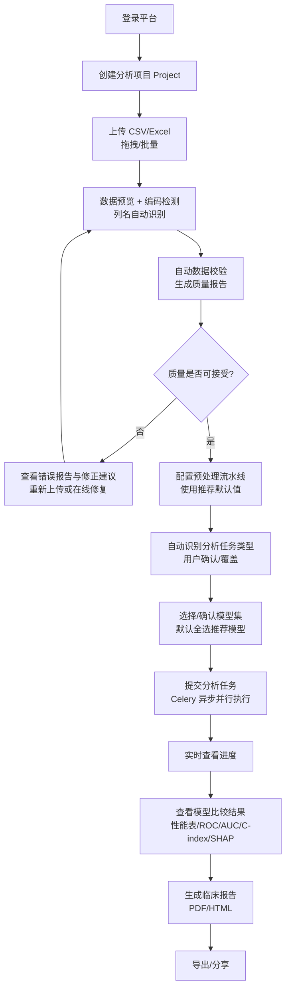

# 01. 业务需求（Business Requirements）

## 1. 用户角色（Personas）

| 角色 | 描述 | 技术能力 | 核心诉求 |
|---|---|---|---|
| **临床研究员**（主要） | 医生/研究生，手头有回顾性队列数据 | 不会编程，会用 Excel | 上传数据→拿到可用于论文的分析报告 |
| **科研 PI** | 审阅下属分析结果 | 无编程 | 查看报告、比较不同模型结论 |
| **数据管理员** | 维护平台、导入数据 | 懂基本 IT | 批量上传、数据质量监控 |
| **平台管理员** | 运维、用户管理 | 懂 Docker | 部署、日志、权限、模型插件管理 |

## 2. 业务流程（端到端）

## 3. 功能需求（FR）

### FR-1 数据导入（Module 1）

| ID | 需求 | 优先级 |
|---|---|---|
| FR-1.1 | 支持 CSV、Excel（.xlsx/.xls）上传，拖拽上传，批量上传 | P0 |
| FR-1.2 | 上传后数据预览（前 100 行 + 列类型推断） | P0 |
| FR-1.3 | 编码自动检测（UTF-8/GBK/GB18030/Latin-1），失败时给出候选 | P0 |
| FR-1.4 | 分隔符自动嗅探（`,` `;` `\t`），表头自动识别 | P0 |
| FR-1.5 | 列名语义自动识别（Age/Gender/Diagnosis/FollowUp/Outcome…），映射到标准字段 | P1 |
| FR-1.6 | 大文件分片上传（>50MB）与断点续传 | P2 |

### FR-2 数据格式检查（Module 2）

| ID | 需求 | 优先级 |
|---|---|---|
| FR-2.1 | 自动检查：字段缺失、非法值、日期格式、重复记录、异常值 | P0 |
| FR-2.2 | 自动区分分类变量/连续变量/日期变量/文本变量 | P0 |
| FR-2.3 | 生成**可读**错误报告：如「缺失字段：Age、Gender、Diagnosis、FollowUp」+ 修正建议 | P0 |
| FR-2.4 | 每列质量画像：缺失率、唯一值数、分布、异常值个数 | P0 |
| FR-2.5 | 支持「阻塞级」与「警告级」问题分级，阻塞级必须处理后才能继续 | P0 |

### FR-3 自动数据预处理（Module 3）

| ID | 需求 | 优先级 |
|---|---|---|
| FR-3.1 | 缺失值处理：删除/均值/中位数/众数/多重插补/KNN 插补，按列可配 | P0 |
| FR-3.2 | 编码：One-Hot / Label / Ordinal / Target 编码 | P0 |
| FR-3.3 | 标准化/归一化：Standard / MinMax / Robust | P0 |
| FR-3.4 | 异常值检测：IQR / Z-score / Isolation Forest，处理策略可配 | P0 |
| FR-3.5 | 特征选择：方差阈值/相关性过滤/单变量统计/LASSO | P1 |
| FR-3.6 | 特征工程：日期派生（随访时长）、临床评分组合列 | P2 |
| FR-3.7 | **整条流水线可配置**，提供「推荐默认配置」一键使用 | P0 |
| FR-3.8 | 预处理步骤全记录（审计与报告复现） | P0 |

### FR-4 自动识别分析任务（Module 4）

| ID | 需求 | 优先级 |
|---|---|---|
| FR-4.1 | 自动检测列语义：生存时间列、事件列（死亡/复发）、二分类结局、多分类标签、连续标签 | P0 |
| FR-4.2 | 根据数据自动推荐任务类型：Survival / Classification / Regression / Risk Prediction / Prognosis | P0 |
| FR-4.3 | 给出推荐理由与置信度；**用户可确认或修改**（对原需求的修正） | P0 |
| FR-4.4 | 识别失败时回退为「手动选择任务类型」 | P0 |

### FR-5 多模型分析（Module 5）

| ID | 需求 | 优先级 |
|---|---|---|
| FR-5.1 | 同一份数据多模型并行运行（Celery 任务组） | P0 |
| FR-5.2 | 生存分析：Kaplan-Meier、CoxPH、Random Survival Forest、DeepSurv、GradientBoostingSurvival | P0 |
| FR-5.3 | 分类：LogisticRegression、RandomForest、SVM、XGBoost、LightGBM、CatBoost | P0 |
| FR-5.4 | 回归：LASSO、ElasticNet、RandomForest、XGBoost | P1 |
| FR-5.5 | 每个模型运行失败不影响其他模型（隔离 + 失败原因展示） | P0 |
| FR-5.6 | 模型可扩展：通过插件注册新模型，不改核心代码 | P0 |

### FR-6 模型比较（Module 6）

| ID | 需求 | 优先级 |
|---|---|---|
| FR-6.1 | 自动汇总性能表：分类（AUC/准确率/Precision/Recall/F1）；生存（C-index/IBS）；回归（RMSE/MAE/R²） | P0 |
| FR-6.2 | 图表：ROC、校准曲线、决策曲线（DCA）、混淆矩阵、KM 曲线 | P0 |
| FR-6.3 | 可解释性：SHAP 摘要图、特征重要性 | P0 |
| FR-6.4 | 自动排序 Top1/Top2/Top3 并给出推荐原因（主要指标 + 校准 + 稳定性） | P0 |
| FR-6.5 | 交叉验证均值±标准差，避免单次划分偶然性 | P0 |

### FR-7 临床报告（Module 7）

| ID | 需求 | 优先级 |
|---|---|---|
| FR-7.1 | 输出**一份完整报告**（非几十张散图/CSV），结构：数据概况/数据质量/预处理过程/模型说明/模型表现/图表/统计结果/医学解释/推荐模型/局限性/结论 | P0 |
| FR-7.2 | 格式：PDF + HTML（P0）；Markdown + Word（P2） | 见修正 |
| FR-7.3 | 报告模板可配置（语言：中文优先；期刊风格预留） | P1 |
| FR-7.4 | 报告中自动附「仅供科研参考，不构成临床诊断建议」声明 | P0 |
| FR-7.5 | 报告可复现：附数据指纹（hash）、参数快照、软件版本 | P1 |

## 4. 非功能需求（NFR）

| 类别 | 需求 |
|---|---|
| 性能 | 10 万行 × 50 列，12 模型全链路 ≤ 10 分钟（4C8G）；上传 100MB 文件不阻塞 UI |
| 可用性 | 全中文 UI；非编程用户无培训可用；所有等待 >2s 的操作有进度反馈 |
| 安全 | 登录鉴权（JWT）；项目级数据隔离；密码 BCrypt；上传文件类型/大小白名单 |
| 合规 | 数据默认仅存储于部署方本地；提供数据删除（GDPR 式擦除）；操作审计日志 |
| 可靠 | 分析任务失败可重试；单模型失败不拖垮整体；服务重启后任务可恢复 |
| 可维护 | 后端核心模块测试覆盖率 ≥ 80%；结构化日志；OpenAPI 文档自动生成 |
| 可扩展 | 模型/数据格式/报告模板三类插件点；REST API 全部能力对外开放 |
| 兼容 | Chrome/Edge 最近两个大版本 |

## 5. 验收场景（User Acceptance Scenarios）

**场景 A（生存分析）**：研究员上传包含 `age, gender, stage, os_months, death` 的 CSV → 平台提示数据质量 OK（2 个警告）→ 自动推荐「生存分析」（理由：检测到生存时间列 os_months + 事件列 death）→ 运行 KM/CoxPH/RSF/DeepSurv/GBS 5 模型 → 对比表显示 RSF C-index 最高且校准良好被推荐 → 导出 PDF 报告含 KM 曲线、C-index 森林图、SHAP。

**场景 B（坏数据）**：上传缺少结局列的 CSV → 校验报告标红「缺失字段：未检测到结局/标签列」并给出示例格式 → 用户重新上传修正版继续。

**场景 C（二分类）**：上传含 `diagnosis`(0/1) 化验指标 → 自动推荐分类任务 → 6 个分类模型并行 → ROC 对比 + DCA → 推荐 LightGBM（AUC 最高且校准最好）→ 报告含混淆矩阵与 SHAP。
