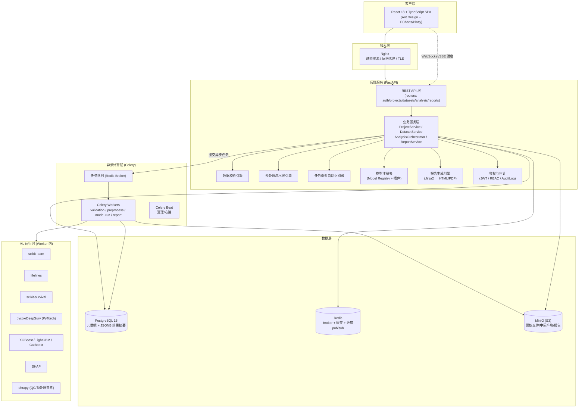
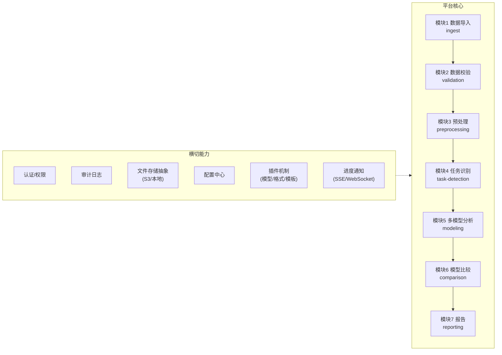
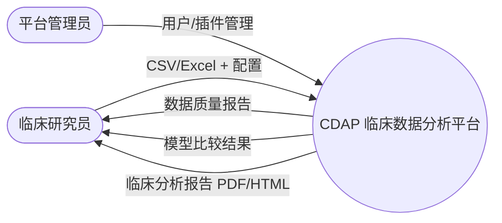
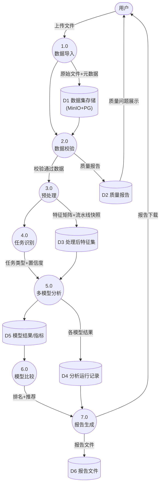
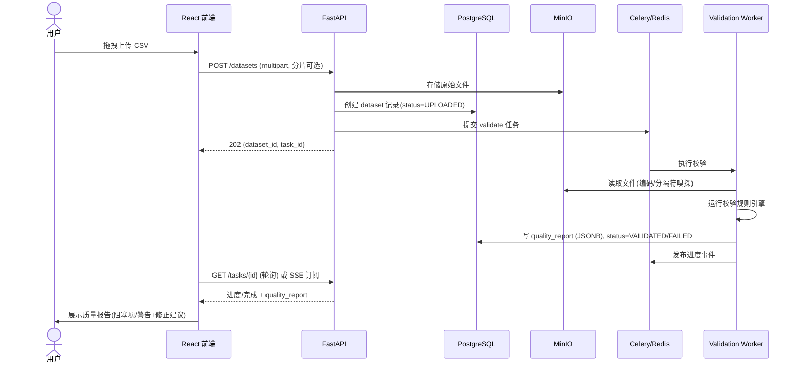
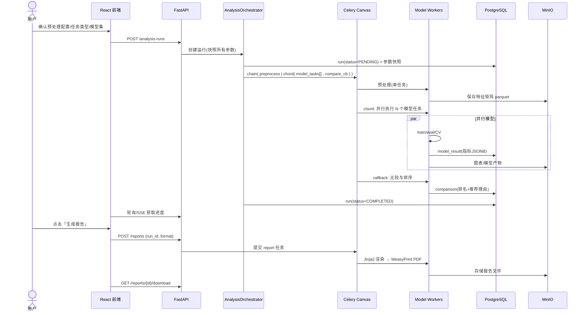

# 02. 系统架构（System Architecture）

## 1. 总体架构



## 2. 架构分层职责

| 层 | 组件 | 职责 | 不做的事 |
|---|---|---|---|
| 客户端 | React SPA | 上传、配置向导、进度展示、结果可视化、报告预览下载 | 任何计算 |
| 接入层 | Nginx | TLS、静态资源、反代、请求大小限制 | 业务逻辑 |
| API 层 | FastAPI routers | 请求校验（Pydantic）、鉴权、DTO 转换 | 计算、SQL 细节 |
| 服务层 | Services | 业务编排、事务、任务提交、结果聚合 | HTTP 细节 |
| 引擎层 | Validation/Preprocess/Registry/Report | 可独立测试的领域引擎，纯 Python | 依赖 FastAPI |
| 计算层 | Celery Workers | 长任务执行：校验、预处理、模型训练评估、报告渲染 | HTTP |
| 数据层 | PG/Redis/MinIO | 持久化、消息、缓存、对象存储 | — |

> **关键原则**：引擎层（Validation/Preprocess/Model/Report）不依赖 Web 框架，可被 API、CLI、未来 MCP Server 三种入口复用。

## 3. 模块架构图



## 4. 数据流图（DFD）

### Level 0



### Level 1



## 5. 关键时序图

### 5.1 上传与校验



### 5.2 分析与报告



## 6. 部署拓扑（逻辑）

```mermaid
flowchart TB
    subgraph DockerHost["单机 Docker Compose (v1 默认)"]
        C1[frontend (nginx+静态)]
        C2[api (fastapi, uvicorn x2)]
        C3[worker (celery, concurrency=CPU)]
        C4[beat]
        C5[(postgres)]
        C6[(redis)]
        C7[(minio)]
    end
    C1 --> C2
    C2 --> C5 & C6 & C7
    C3 --> C5 & C6 & C7
```

K8s 拓扑见 [21-Deployment](21-Deployment.md)。

## 7. 目录结构（后端 monorepo）

```
cdap/
├── backend/
│   ├── app/
│   │   ├── main.py                  # FastAPI 入口
│   │   ├── core/                    # 配置/安全/日志/异常
│   │   ├── api/v1/                  # routers: auth,projects,datasets,analysis,reports,plugins
│   │   ├── services/                # 业务服务层
│   │   ├── engines/                 # 领域引擎（框架无关，纯 Python）
│   │   │   ├── validation/          # 规则引擎 + 质量画像
│   │   │   ├── preprocessing/       # Pipeline DSL + 步骤实现
│   │   │   ├── task_detection/      # 列语义识别 + 任务推荐
│   │   │   ├── modeling/            # 模型适配器 + 注册表
│   │   │   ├── comparison/          # 指标汇总 + 排序推荐
│   │   │   └── reporting/           # 模板渲染 + 导出器
│   │   ├── models/                  # SQLAlchemy ORM
│   │   ├── schemas/                 # Pydantic DTO
│   │   ├── workers/                 # Celery 任务定义
│   │   ├── plugins/                 # 内置模型插件
│   │   └── tests/
│   ├── alembic/                     # 迁移
│   ├── pyproject.toml
│   └── Dockerfile
├── frontend/
│   ├── src/
│   │   ├── pages/                   # Login/Projects/Dataset/Wizard/Results/Reports/Admin
│   │   ├── components/              # UploadZone/QualityReport/ModelTable/Charts
│   │   ├── api/                     # OpenAPI 生成客户端
│   │   └── stores/                  # Zustand
│   └── Dockerfile
├── deploy/
│   ├── docker-compose.yml
│   └── k8s/
└── docs/                            # 本目录
```

## 8. 横切设计要点

- **日志**：structlog JSON 日志，request_id/run_id 贯穿 API→Worker。
- **异常**：统一 `AppError(code, message, details)` → RFC7807 风格错误响应（错误码表见 14 章）。
- **权限**：JWT + 角色（admin/researcher/viewer），项目级隔离：`project.owner_id` 强制过滤。
- **缓存**：Redis 缓存模型注册表、任务进度；结果不缓存（每次运行独立快照）。
- **进度通知**：v1 用轮询（简单可靠）+ SSE 作为增强；WebSocket 非必需。
