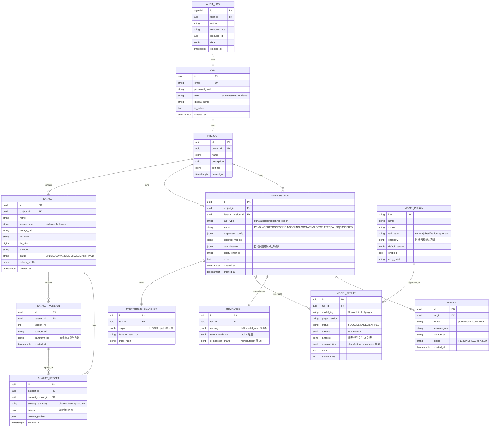

# 04. 数据模型（Data Model）

> 数据库物理设计（表 DDL、索引）见 [13-Database-Design](13-Database-Design.md)；本章聚焦领域概念模型与数据语义。

## 1. 领域概念 ER 图



## 2. 核心实体语义

| 实体 | 说明 | 关键设计点 |
|---|---|---|
| Project | 用户工作空间 | 权限隔离边界；settings 存默认预处理偏好 |
| Dataset / DatasetVersion | 原始上传 + 版本化修复 | 原始文件永不覆盖；在线修复产生新版本（可复现） |
| QualityReport | 校验结果 | issues 为结构化 JSON（rule_id/severity/column/rows/message/suggestion），前端直接渲染 |
| AnalysisRun | 一次完整分析 | **参数全快照**（预处理配置/模型集/任务类型）保证可复现；状态机驱动 |
| PreprocessSnapshot | 预处理固化 | 记录每步统计量（均值/编码映射），使未来预测/复跑可重放 |
| ModelResult | 单模型结果 | 指标 JSONB：`{metric: {mean, std, folds[]}}`；失败也落库（error 字段） |
| Comparison | 比较结论 | ranking 为有序数组；recommendation 含自然语言理由模板 |
| Report | 报告产物 | 一次 run 可生成多格式多份 |
| ModelPlugin | 模型注册表 | 数据库存「启用状态/默认参数」，代码实现经 entry_points 加载（见 15 章） |

## 3. 分析结果 JSONB 结构约定

**ModelResult.metrics（分类示例）**
```json
{
  "auc":      {"mean": 0.873, "std": 0.021, "folds": [0.86, 0.88, 0.87, 0.89, 0.86]},
  "accuracy": {"mean": 0.81,  "std": 0.03},
  "precision": {"mean": 0.79}, "recall": {"mean": 0.77}, "f1": {"mean": 0.78},
  "brier":    {"mean": 0.121}
}
```
**生存分析**：`c_index`、`ibs`(integrated brier score)；**回归**：`rmse`、`mae`、`r2`。

**Comparison.recommendation**
```json
{
  "ranking": ["rsf", "coxph", "deepsurv"],
  "top": [
    {"model_key": "rsf", "rank": 1, "reason": "主指标最高（c_index=0.780±0.030），校准/拟合优度最优（ibs=0.120）"},
    {"model_key": "coxph", "rank": 2, "reason": "主指标接近首位（c_index=0.760±0.020，差距 0.020），交叉验证最稳定（std=0.020）"}
  ],
  "not_recommended": [
    {"model_key": "deepsurv", "reason": "交叉验证波动最大（std=0.090）"}
  ],
  "primary_metric": "c_index",
  "formula": "score = 0.6×主指标归一化 + 0.2×稳定性归一化 + 0.2×次级指标归一化（docs/09 §4.1）",
  "scores": [
    {"model_key": "rsf", "score": 0.91, "components": {"primary": 1.0, "stability": 0.6, "secondary": 1.0}}
  ]
}
```
理由由模板引擎基于指标事实生成，只引用真实计算值（docs/09 §4.2）。

## 4. 数据保留与隐私

- 软删除：Dataset/Report 删除 → MinIO 对象标记 + PG 记录 `deleted_at`（字段见 13 章）；管理员可配置保留期后物理清除。
- 数据不出部署边界：平台无任何外部遥测上报。
