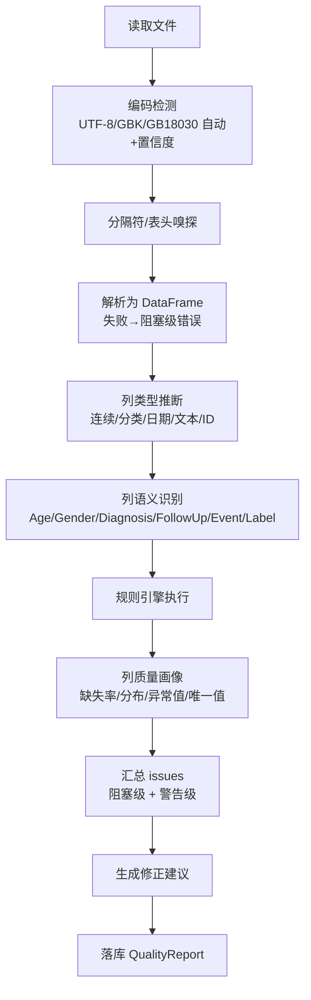

# 05. 数据校验（Data Validation）

> 模块 2。职责：在任何分析前自动发现数据问题，输出**人可读**的质量报告与修正建议。引擎位于 `engines/validation/`，纯 Python，框架无关。

## 1. 模块卡片

| 项 | 内容 |
|---|---|
| 职责 | 编码/分隔符嗅探 → 解析 → 列类型推断 → 规则引擎 → 质量画像 → 质量报告 |
| 输入 | 原始文件（S3 uri）、可选的目标 schema 声明 |
| 输出 | `QualityReport`（issues 结构化 JSON + 列画像）、状态 VALIDATED/FAILED |
| 依赖 | pandas、charset-normalizer、Pandera（可选）、`engines/task_detection`（列语义识别复用） |
| 接口 | `validate(dataset_uri, config) -> QualityReport`；API `POST /datasets/{id}/validate` |
| 复杂度 | 中 |
| 风险 | 临床列名千奇百怪 → 语义识别需词典+规则+置信度，允许人工修正映射 |

## 2. 校验流程



## 3. 规则目录（v1）

| 规则 ID | 类别 | 级别 | 描述 | 修正建议模板 |
|---|---|---|---|---|
| RV001 | 结构 | 阻塞 | 文件无法解析（编码/格式） | 「检测到编码可能为 GBK，请转换后重传」 |
| RV002 | 结构 | 阻塞 | 空表 / 仅表头 | 「文件不含数据行」 |
| RV003 | 结构 | 阻塞 | 重复列名 | 「列 X 出现 N 次，请重命名」 |
| RV101 | 字段 | 阻塞 | 任务必需字段缺失（识别不到结局/标签列） | 「未检测到结局列，示例：death(0/1) 或 os_months+event」 |
| RV102 | 字段 | 警告 | 推荐字段缺失（Age/Gender 等） | 「建议补充 Age 列以支持年龄分层」 |
| RV201 | 缺失 | 警告/阻塞 | 列缺失率 > 阈值（默认 50% 阻塞、20% 警告） | 「列 X 缺失 62%，建议删除或插补」 |
| RV301 | 类型 | 阻塞 | 数值列混入非法值（如「未知」「>100」） | 「发现 N 个非数值，可在线替换为缺失」 |
| RV302 | 日期 | 警告 | 日期格式不一致（多格式混杂） | 「检测到 3 种日期格式，将统一解析为 YYYY-MM-DD」 |
| RV401 | 重复 | 警告 | 完全重复行 / 疑似同一患者重复（ID 列重复） | 「发现 N 行完全重复，可在线去重」 |
| RV501 | 异常值 | 警告 | IQR/Z-score 异常（按列类型） | 「Age 存在 3 个异常值（<0 或 >120）」 |
| RV502 | 范围 | 警告 | 临床不合理范围（内置常见检验/体征范围词典） | 「血钾 0.2 mmol/L 超出合理范围」 |
| RV601 | 分类变量 | 信息 | 高基数分类（唯一值 > 50） | 「列 X 唯一值 120 个，建议合并或视为文本」 |
| RV701 | 标签 | 警告 | 标签极端不平衡（<5%） | 「阳性率 2.1%，建议使用 class_weight 与 PR-AUC」 |

## 4. 质量报告输出示例（前端渲染源）

```json
{
  "dataset_id": "…", "status": "FAILED",
  "summary": {"rows": 1523, "columns": 28, "blockers": 2, "warnings": 5},
  "issues": [
    {"rule_id": "RV101", "severity": "blocker",
     "message": "缺失字段：未检测到结局/标签列",
     "detail": "已扫描 28 列，未匹配到生存时间/事件/分类标签/连续标签",
     "suggestion": "请添加如 death(0/1) 或 os_months+death 列；参考模板下载"},
    {"rule_id": "RV201", "severity": "warning", "column": "ALP",
     "message": "缺失率 34.2%", "affected_rows": 521,
     "suggestion": "可在预处理中选择中位数插补或删除该列"}
  ],
  "column_profiles": [
    {"name": "age", "inferred_type": "continuous", "semantic": "Age",
     "missing_rate": 0.0, "unique": 67, "min": 21, "max": 89, "outliers": 0}
  ]
}
```

## 5. 在线修复（Quick Fix）

校验报告的每条警告可提供**一键修复动作**（产生新 DatasetVersion，不改原文件）：

| 动作 | 说明 |
|---|---|
| 删除列 | 高缺失/无用列 |
| 删除重复行 | RV401 |
| 非法值→缺失 | RV301，预览影响行后确认 |
| 列语义重映射 | 用户下拉指定「此列 = 生存时间」 |

## 6. 性能与边界

- 流式分块读取（`chunksize=50k`），10 万行全规则 ≤ 30s。
- 内存上限：>100 万行时异常值检测采样执行并在报告中注明。
- 所有阈值集中在 `validation_config`，项目级可覆盖。

## 7. DoD

- [ ] 18 条规则全部实现且各自有单测（含正/反例）
- [ ] 阻塞/警告分级正确驱动前端「能否继续」
- [ ] 质量报告 JSON 与前端组件联调通过
- [ ] 10 万行 CSV 校验 ≤ 30s 的性能测试通过
