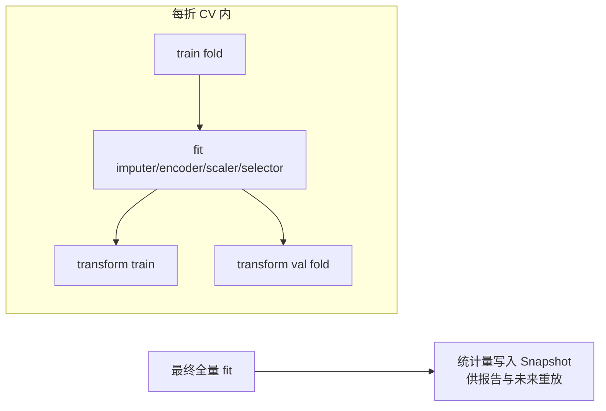

# 06. 预处理流水线（Preprocessing Pipeline）

> 模块 3 + Phase 7 前半段。职责：把校验通过的数据变成可直接建模的特征矩阵，全程**可配置、可复现、可审计**。引擎位于 `engines/preprocessing/`。

## 1. 模块卡片

| 项 | 内容 |
|---|---|
| 职责 | （长表→宽表整形）→ 缺失值 → 异常值 → 编码 → 缩放 → 特征选择 → 特征工程，输出训练/验证特征矩阵 |
| 输入 | DatasetVersion、`preprocess_config`（JSON） |
| 输出 | 特征矩阵 parquet（S3）、PreprocessSnapshot（步骤+统计量）、预处理报告摘要 |
| 依赖 | pandas、scikit-learn、ehrapy 思路（见 16 章） |
| 接口 | `run_pipeline(df, config) -> (X_train, X_val, snapshot)` |
| 复杂度 | 高（可配置性 + 复现性） |
| 风险 | 数据泄漏（fit 泄漏到验证集）→ 所有统计量只在训练折 fit |

## 2. 流水线 DSL（配置即数据）

```json
{
  "target": {"time_col": "os_months", "event_col": "death"},
  "steps": [
    {"type": "reshape", "params": {
        "mode": "long_to_wide", "index": "患者ID",
        "columns": "检验名称", "values": "归一化值", "agg": "first"}},
    {"type": "drop_columns", "params": {"columns": ["patient_id"]}},
    {"type": "missing", "params": {
        "default": "median",
        "per_column": {"stage": "mode"},
        "drop_threshold": 0.5}},
    {"type": "outlier", "params": {"method": "iqr", "action": "clip", "columns": "continuous"}},
    {"type": "encode", "params": {"method": "auto",
        "onehot_max_cardinality": 10, "ordinal_columns": {"stage": ["I","II","III","IV"]}}},
    {"type": "scale", "params": {"method": "standard", "columns": "continuous"}},
    {"type": "feature_select", "params": {"method": "variance_threshold", "threshold": 0.0}},
    {"type": "derive", "params": {"expressions": [
        {"name": "followup_years", "expr": "os_months / 12"}]}}
  ],
  "validation": {"strategy": "stratified_kfold", "n_splits": 5, "test_size": 0.2, "seed": 42}
}
```

前端提供「推荐默认配置」按钮：由 `task_detection` 按列类型自动生成上述 JSON，用户逐项可调。

**验证策略与任务类型一致性（2026-08-05 补充）**：`stratified_kfold` 仅适用于分类（按 label 分层）与生存（按 event 分层）；回归任务无类别可分层，使用该策略会在每折报错「stratified_kfold 需要 y」导致全部模型失败。约定：创建分析运行时服务端强制将回归任务的 `stratified_kfold` 降级为 `kfold`（落库配置即修正后版本）；前端向导在切换任务类型为回归时同步替换，保证步骤 5 摘要所见即所得。

**结局变量与任务类型硬校验（2026-08-10 补充）**：创建分析运行时，服务端在落库前对 target 列做数据级校验，**只拦截数学上必然失败的情形**（方法学建议仍由任务识别推荐层以软提示呈现，不拦截）：

1. **target 列存在性**：`label_col`/`time_col`/`event_col` 必须在数据文件中存在，否则 400 `VALIDATION_ERROR`（列名笔误 otherwise 必在 worker 阶段失败）；
2. **回归 + 非数值结局**：`label_col` 既非数值 dtype 且不可强制转数值（可转比例 <90%，与列类型推断同口径）→ 400，文案引导改用「分类 / 风险预测」；
3. **分类 + 类别数不足**：`label_col` 有效取值 <2 类 → 400（分类至少需要两个类别）；
4. **分类 + 分层抽样不可行**：`stratified_kfold` 下某类别样本数 < `n_splits` → 400，文案指出类别名、样本数与折数，建议减少折数或改用 `kfold`。

前端向导在步骤 5（确认页）基于 `column_profile` 镜像规则 1–3（存在性 + `inferred_type` 粗判），违反即禁用提交并给出 Alert；规则 4 需精确类别计数，以后端 400 文案为准（前端 toast 原样展示）。规则 2 中「可转数值 ≥90%」与 `engines/columns.py` 的 `_NUMERIC_PARSE_RATIO` 同口径，避免把字符串型数值误判为文本。

## 3. 步骤实现映射（复用优先）

| 步骤 | 实现 | 复用来源 |
|---|---|---|
| reshape | 长表(EAV)→宽表透视：一行=一个实体一次观测 → 一行=一个患者；多文件（化验+诊断）按主键 join 后透视 | pandas `pivot_table` / `merge`（见 §3.1 真实数据适配） |
| missing | median/mode/KNN/多重插补 | sklearn `SimpleImputer`/`KNNImputer`/`IterativeImputer`；策略思想参考 ehrapy `ep.pp` |
| outlier | IQR clip / Z-score / IsolationForest | sklearn |
| encode | One-Hot/Ordinal/Target | sklearn / category_encoders |
| scale | Standard/MinMax/Robust | sklearn |
| feature_select | 方差/相关/单变量/LASSO | sklearn `feature_selection` |
| derive | 受限表达式引擎（白名单函数） | 自研（安全沙箱，禁止 eval 任意代码） |

> derive 表达式用 `simpleeval` 白名单求值，防注入。

### 3.1 真实数据适配（2026-07-29 蓝图修订）

项目真实测试数据（`mysql/{训练,测试,验证}集/样本集*/`）为**长表格式**：
`化验.csv`（患者ID, 检验名称, 归一化值, …，一行=一项检验）+ `诊断.csv`（患者ID, 诊断, 年龄, 性别）。

因此 `reshape` 是**第一优先级步骤**：宽表数据上传时该步骤自动跳过；检测到长表（存在重复主键 + 名称/值列对）时推荐配置自动插入。校验模块（05 章）相应增加长表结构识别规则。

> 边界（2026-08-03）：`reshape` 处理**单文件简单长表**的纯透视。多文件临床组装（化验+诊断 join、结局派生、时间窗防泄漏、药敏剔除）属上游「数据准备」阶段（05 章 §8，engines/preparation），产出宽表数据集后再进入本流水线。

## 4. 防泄漏与可复现



- 每步实现 `fit/transform` 协议（sklearn 兼容），组装为 `sklearn.Pipeline`。
- Snapshot 记录：步骤顺序、参数、每步拟合统计量、输入文件 hash、库版本 → **报告附「可复现性信息」**。

## 5. 输出

| 产物 | 位置 | 用途 |
|---|---|---|
| `features/{run_id}/train.parquet` | MinIO | 模型训练 |
| `preprocess_snapshot` 行 | PG | 审计/复现/报告 |
| 预处理摘要（每步影响行数/列数/警告） | JSONB | 报告「预处理过程」章节 |

## 6. DoD

- [ ] 7 类步骤全部实现 + 单测（含边界：全缺失列、单值列、未知类别出现在验证集）
- [ ] 泄漏测试：scaler 的均值仅来自 train fold（断言验证集统计不影响）
- [ ] 同一 config + 同一数据 → 两次运行特征矩阵逐位相等（seed 固定）
- [ ] Snapshot 可用于重放 transform（集成测试）
