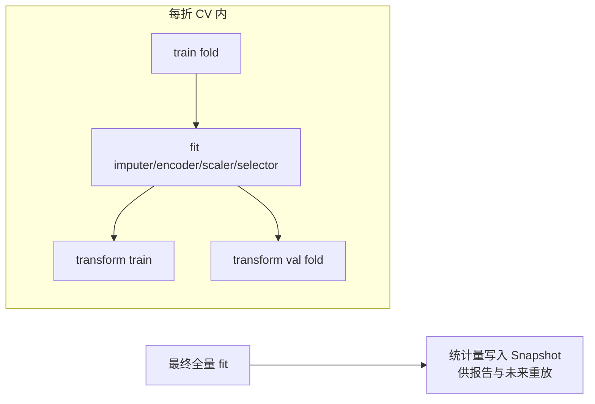

# 06. 预处理流水线（Preprocessing Pipeline）

> 模块 3 + Phase 7 前半段。职责：把校验通过的数据变成可直接建模的特征矩阵，全程**可配置、可复现、可审计**。引擎位于 `engines/preprocessing/`。

## 1. 模块卡片

| 项 | 内容 |
|---|---|
| 职责 | 缺失值 → 异常值 → 编码 → 缩放 → 特征选择 → 特征工程，输出训练/验证特征矩阵 |
| 输入 | DatasetVersion、`preprocess_config`（JSON） |
| 输出 | 特征矩阵 parquet（S3）、PreprocessSnapshot（步骤+统计量）、预处理报告摘要 |
| 依赖 | pandas、scikit-learn、ehrapy 思路（见 16 章） |
| 接口 | `run_pipeline(df, config) -> (X_train, X_val, snapshot)` |
| 复杂度 | 高（可配置性 + 复现性） |
| 风险 | 数据泄漏（fit 泄漏到验证集）→ 所有统计量只在训练折 fit |

## 2. 流水线 DSL（配置即数据）

```json
{
  "target": {"time_col": "os_months", "event_col": "death"},
  "steps": [
    {"type": "drop_columns", "params": {"columns": ["patient_id"]}},
    {"type": "missing", "params": {
        "default": "median",
        "per_column": {"stage": "mode"},
        "drop_threshold": 0.5}},
    {"type": "outlier", "params": {"method": "iqr", "action": "clip", "columns": "continuous"}},
    {"type": "encode", "params": {"method": "auto",
        "onehot_max_cardinality": 10, "ordinal_columns": {"stage": ["I","II","III","IV"]}}},
    {"type": "scale", "params": {"method": "standard", "columns": "continuous"}},
    {"type": "feature_select", "params": {"method": "variance_threshold", "threshold": 0.0}},
    {"type": "derive", "params": {"expressions": [
        {"name": "followup_years", "expr": "os_months / 12"}]}}
  ],
  "validation": {"strategy": "stratified_kfold", "n_splits": 5, "test_size": 0.2, "seed": 42}
}
```

前端提供「推荐默认配置」按钮：由 `task_detection` 按列类型自动生成上述 JSON，用户逐项可调。

## 3. 步骤实现映射（复用优先）

| 步骤 | 实现 | 复用来源 |
|---|---|---|
| missing | median/mode/KNN/多重插补 | sklearn `SimpleImputer`/`KNNImputer`/`IterativeImputer`；策略思想参考 ehrapy `ep.pp` |
| outlier | IQR clip / Z-score / IsolationForest | sklearn |
| encode | One-Hot/Ordinal/Target | sklearn / category_encoders |
| scale | Standard/MinMax/Robust | sklearn |
| feature_select | 方差/相关/单变量/LASSO | sklearn `feature_selection` |
| derive | 受限表达式引擎（白名单函数） | 自研（安全沙箱，禁止 eval 任意代码） |

> derive 表达式用 `simpleeval` 白名单求值，防注入。

## 4. 防泄漏与可复现



- 每步实现 `fit/transform` 协议（sklearn 兼容），组装为 `sklearn.Pipeline`。
- Snapshot 记录：步骤顺序、参数、每步拟合统计量、输入文件 hash、库版本 → **报告附「可复现性信息」**。

## 5. 输出

| 产物 | 位置 | 用途 |
|---|---|---|
| `features/{run_id}/train.parquet` | MinIO | 模型训练 |
| `preprocess_snapshot` 行 | PG | 审计/复现/报告 |
| 预处理摘要（每步影响行数/列数/警告） | JSONB | 报告「预处理过程」章节 |

## 6. DoD

- [ ] 7 类步骤全部实现 + 单测（含边界：全缺失列、单值列、未知类别出现在验证集）
- [ ] 泄漏测试：scaler 的均值仅来自 train fold（断言验证集统计不影响）
- [ ] 同一 config + 同一数据 → 两次运行特征矩阵逐位相等（seed 固定）
- [ ] Snapshot 可用于重放 transform（集成测试）
