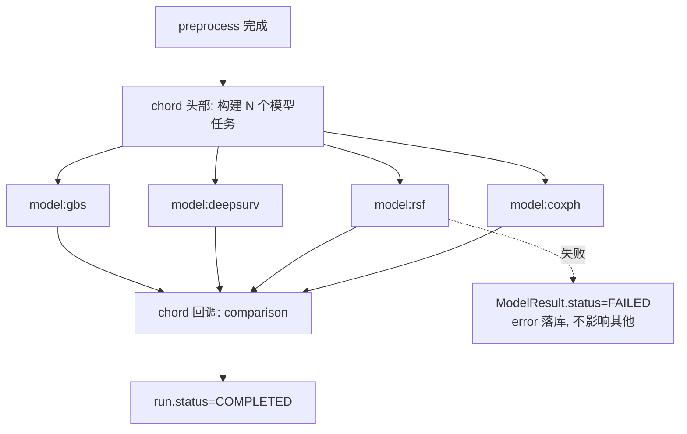

# 07. ML 模型管理（ML Model Management）

> 模块 5 的模型侧 + 模型注册机制。职责：统一模型协议、注册表、并行执行与失败隔离。引擎位于 `engines/modeling/`。

## 1. 模块卡片

| 项 | 内容 |
|---|---|
| 职责 | 模型插件加载 → 按任务类型筛选 → 并行训练/评估 → 指标与产物落库 |
| 输入 | 特征矩阵（train/val）、task_type、selected_models、参数覆盖 |
| 输出 | 每模型 `ModelResult`（metrics/artifacts/explainability/error） |
| 依赖 | sklearn/lifelines/scikit-survival/pycox/xgboost/lightgbm/catboost/shap |
| 接口 | `ModelAdapter` 协议 + `ModelRegistry` |
| 复杂度 | 高 |
| 风险 | 单模型崩溃/超时拖垮整体 → 任务级隔离 + 超时 + 失败落库继续 |

## 2. 模型适配器协议

```python
class ModelAdapter(Protocol):
    key: str                      # "coxph"
    name: str                     # "Cox Proportional Hazards"
    version: str
    task_types: list[str]         # ["survival"]
    capabilities: dict            # {"shap": True, "feature_importance": True, "calibration": True}
    default_params: dict

    def fit(self, X, y, params: dict) -> None: ...
    def evaluate(self, X_val, y_val) -> dict: ...        # 返回原始指标 dict
    def explain(self, X_val) -> dict | None: ...         # shap/importance
    def predict_artifacts(self, X_val, y_val) -> dict: ... # 生成图表数据(roc/km/calibration)
```

任何满足协议的类经 entry_points 注册即可被平台发现（插件机制详见 [15-Plugin-System](15-Plugin-System.md)）。

## 3. 内置模型清单（v1）

| key | 模型 | 任务 | 库 | 主要指标 |
|---|---|---|---|---|
| `km` | Kaplan-Meier | survival（基线/图表） | lifelines | KM 曲线、log-rank |
| `coxph` | Cox 比例风险 | survival | lifelines | C-index、HR 森林图 |
| `rsf` | Random Survival Forest | survival | scikit-survival | C-index、IBS |
| `gbs` | Gradient Boosting Survival | survival | scikit-survival | C-index、IBS |
| `deepsurv` | DeepSurv | survival | pycox/PyTorch(CPU) | C-index |
| `logreg` | Logistic Regression | classification | sklearn | AUC/F1/校准 |
| `rf` | Random Forest | classification/regression | sklearn | AUC/RMSE |
| `svm` | SVM(probability) | classification | sklearn | AUC |
| `xgboost` | XGBoost | classification/regression | xgboost | AUC/RMSE |
| `lightgbm` | LightGBM | classification/regression | lightgbm | AUC/RMSE |
| `catboost` | CatBoost | classification/regression | catboost | AUC/RMSE |
| `lasso` | LASSO | regression/特征选择 | sklearn | RMSE |
| `elasticnet` | ElasticNet | regression | sklearn | RMSE |

任务识别结果自动过滤可用模型：`task_type=survival` → 仅 survival 模型进入候选。

## 4. 执行编排



- 每模型任务：5 折 CV 评估 + 全量 fit + explain + artifacts。
- 超时：默认单模型 15 min（可配）；超期终止并记 FAILED。
- 资源：worker 并发 = CPU 核数；DeepSurv 限 CPU 线程， epochs 默认 100 可配。
- 随机种子：统一 `seed=42` 注入所有模型与 CV 划分。

## 5. 统一指标计算

指标计算**不收在各模型内**，由 `engines/comparison/metrics.py` 统一实现，模型只输出预测值（风险分/概率/预测值），保证横向可比：

| 任务 | 指标集 |
|---|---|
| survival | C-index（主）、IBS、time-dependent AUC（可选） |
| classification | AUC（主）、Accuracy、Precision、Recall、F1、Brier、PR-AUC（不平衡时） |
| regression | RMSE（主）、MAE、R² |

## 6. 可解释性

- GBDT 树模型（XGBoost/LightGBM/CatBoost）：SHAP TreeExplainer（C++ 快路径）摘要图 + Top20 特征重要性。
- sklearn 原生森林（RF/RSF）：内置 `feature_importances_`（SHAP 对 sklearn 树走 Python 慢路径，
  深度树 10w 行规模不可行——T8.3 实测 RF SHAP >20min；见 §6.1）。
- 线性/Cox：系数/HR 表与森林图。
- 不支持内置重要性的模型（SVM）：permutation importance 兜底。
- 解释产物存 `ModelResult.explainability`（数据）+ PNG（S3，供报告引用）。

### 6.1 大样本保护（T8.3 性能调优；NFR：10w×50 十二模型 ≤10min）

指标计算**始终在全量验证折上**（结果真实，不采样）；以下仅为拟合/解释的工程上限，
均为确定性子采样（seed=42），并在适配器文档与报告中如实标注：

| 环节 | 上限 | 说明 |
|---|---|---|
| SVM 拟合 | `max_train_rows=10000`（默认，可参数覆盖） | SVC 复杂度 ≥O(n²)，全量 10w 不可行；分层子采样拟合 |
| SVM permutation importance | ≤2000 行 | n_repeats=5 全量 predict 代价过高 |
| 树模型 SHAP 摘要 | ≤2000 行；仅 GBDT 快路径 | mean(|SHAP|) 在子样本上估计；sklearn 森林走内置重要性（SHAP Python 慢路径深度树不可行） |
| RF/RSF 拟合 | `n_jobs=-1`（默认参数） | sklearn 系默认单核；NFR 4C8G 须吃满可用核 |

## 7. DoD

- [ ] 13 个内置模型全部以插件形式注册并跑通示例数据
- [ ] 指标统一由 metrics 模块计算（代码审查确认模型适配器不自算 AUC）
- [ ] 故障注入测试：人为让某模型抛异常/超时，其余模型与回调正常完成
- [ ] 新增模型插件（测试用 dummy 模型）零核心代码改动注册成功
