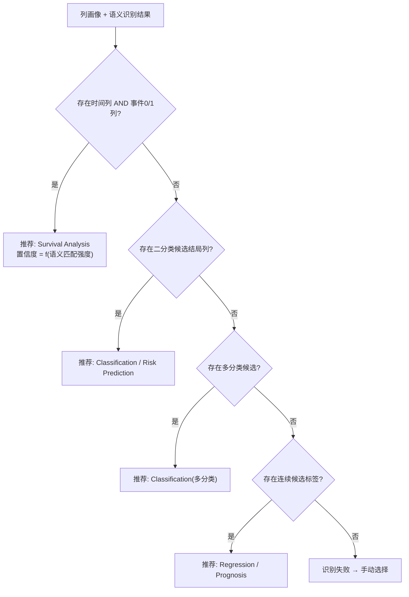
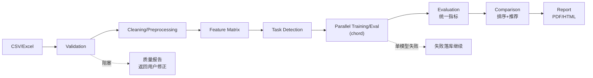
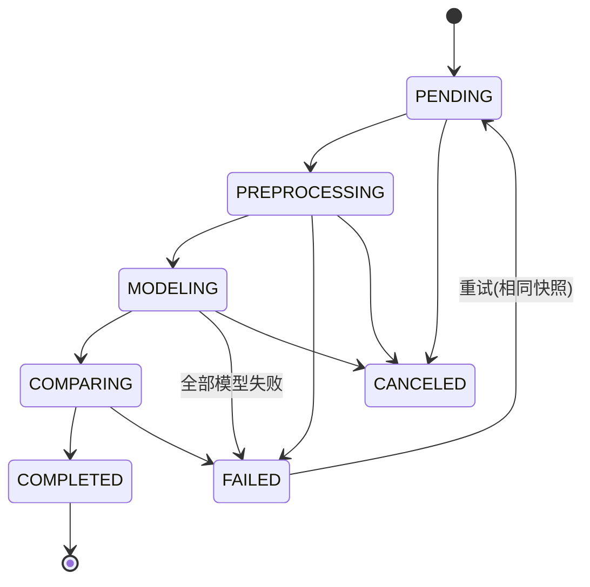

# 08. 分析工作流（Analysis Workflow）

> 模块 4 + Phase 7 全链路编排。职责：自动识别分析任务类型，并把 CSV→报告的全流程编排成可追踪、可恢复的 Celery 工作流。

## 1. 任务类型自动识别（engines/task_detection）

### 1.1 识别逻辑



### 1.2 列语义识别

- **词典匹配**：内置中英文临床列名词典（age/年龄/age_at_dx；os/生存时间/followup/随访；death/死亡/event/status…），用户可在项目设置中扩展词典。
- **模式规则**：`0/1 且列名含 event/death/recur` → 事件列；`正数连续 且与事件列成对出现` → 时间列。
- **置信度**：每个推断附 0–1 置信度与理由文本，前端展示「为什么推荐」。
- **用户确认/覆盖**：推荐结果默认选中，用户一键确认或下拉修改（这是对 DVPlan「不要要求用户自己选择」的修正——自动推荐、人工兜底）。

### 1.3 输出契约

```json
{
  "recommended_task": "survival",
  "confidence": 0.92,
  "reason": "检测到生存时间列 os_months（词典匹配 0.95）与事件列 death（0/1 取值）",
  "candidates": {
    "time_col": [{"column": "os_months", "confidence": 0.95}],
    "event_col": [{"column": "death", "confidence": 0.98}],
    "label_col": [{"column": "diagnosis", "confidence": 0.7}]
  },
  "user_override": null
}
```

## 2. 全链路流水线（Phase 7）



### Celery 编排结构

```
chain(
  preprocess_task.s(run_id),                      # 单任务
  chord(
    header=[model_task.s(run_id, key) for key in selected_models],
    body=comparison_task.s(run_id)                # 全部结束后回调
  )
)
```

## 3. 运行状态机



- 进度计算：preprocess 20% + 每模型 (70%/N) + comparison 10%，写入 Redis 供轮询/SSE。
- 取消：`celery.control.revoke(terminate=True)` + 状态置 CANCELED。
- 重试：同快照重新入队；单模型可在结果页单独重跑。

## 4. 进度通知 API 契约

`GET /analysis-runs/{id}/progress`
```json
{"status": "MODELING", "percent": 55,
 "current_step": "model:lightgbm",
 "models": {"coxph": "SUCCESS", "rsf": "RUNNING", "deepsurv": "PENDING"}}
```

## 5. 模块卡片（工作流编排器）

| 项 | 内容 |
|---|---|
| 职责 | 创建 run 快照、编排 Celery、状态机推进、进度聚合、取消/重试 |
| 输入 | dataset_version_id + 完整配置 |
| 输出 | run 全生命周期记录 |
| 依赖 | Celery canvas、Redis、PG |
| 复杂度 | 高 |
| 风险 | worker 宕机任务悬挂 → `task_acks_late` + 心跳巡检（beat 定时扫描超时 RUNNING 任务标记 FAILED 可重试） |

## 6. DoD

- [ ] 4 种任务类型识别各有 ≥3 个真实/合成数据测试用例，准确率达标（词典内 100%）
- [ ] 识别失败路径回退手动选择，UI 可用
- [ ] chord 编排集成测试：N 模型并行 → 回调触发 → 状态 COMPLETED
- [ ] 取消/重试/单模型重跑集成测试通过
- [ ] worker  kill -9 注入测试：任务被标记并可恢复
