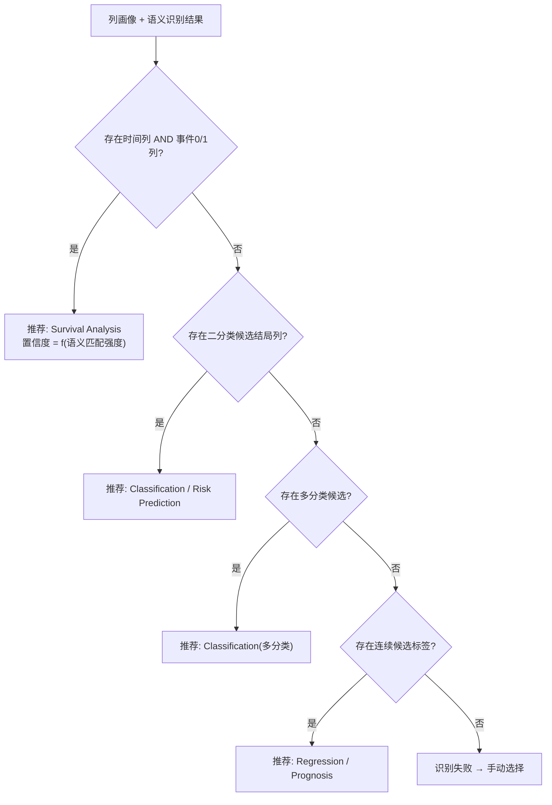
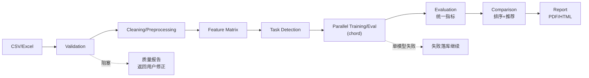
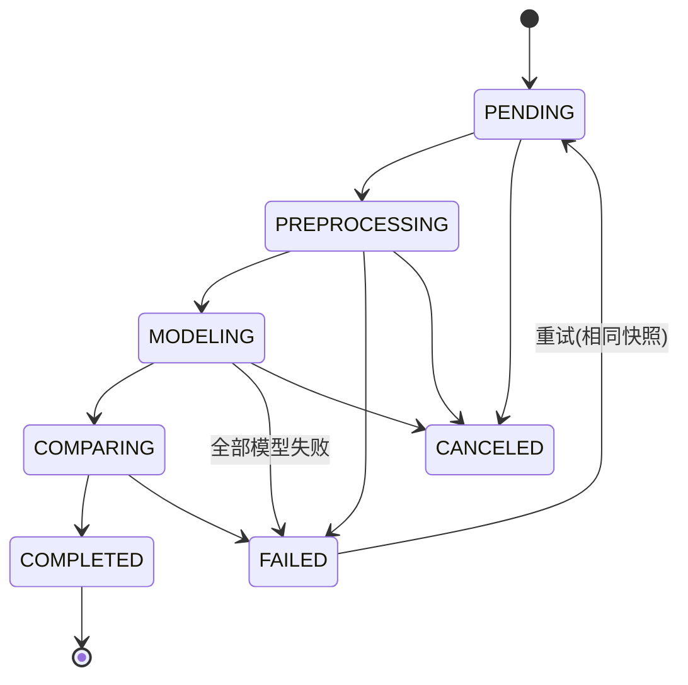

# 08. 分析工作流（Analysis Workflow）

> 模块 4 + Phase 7 全链路编排。职责：自动识别分析任务类型，并把 CSV→报告的全流程编排成可追踪、可恢复的 Celery 工作流。

## 1. 任务类型自动识别（engines/task_detection）

### 1.1 识别逻辑



### 1.2 列语义识别

- **词典匹配**：内置中英文临床列名词典（age/年龄/age_at_dx；os/生存时间/followup/随访；death/死亡/event/status…），用户可在项目设置中扩展词典。
- **模式规则**：`0/1 且列名含 event/death/recur` → 事件列；`正数连续 且与事件列成对出现` → 时间列。
- **置信度**：每个推断附 0–1 置信度与理由文本，前端展示「为什么推荐」。
- **用户确认/覆盖**：推荐结果默认选中，用户一键确认或下拉修改（这是对 DVPlan「不要要求用户自己选择」的修正——自动推荐、人工兜底）。

### 1.3 输出契约

```json
{
  "recommended_task": "survival",
  "confidence": 0.92,
  "reason": "检测到生存时间列 os_months（词典匹配 0.95）与事件列 death（0/1 取值）",
  "candidates": {
    "time_col": [{"column": "os_months", "confidence": 0.95}],
    "event_col": [{"column": "death", "confidence": 0.98}],
    "label_col": [{"column": "diagnosis", "confidence": 0.7}]
  },
  "user_override": null
}
```

## 2. 全链路流水线（Phase 7）



### Celery 编排结构

```
chain(
  preprocess_task.s(run_id),                      # 单任务
  chord(
    header=[model_task.s(run_id, key) for key in selected_models],
    body=comparison_task.s(run_id)                # 全部结束后回调
  )
)
```

## 3. 运行状态机



- 进度计算：preprocess 20% + 每模型 (70%/N) + comparison 10%，写入 Redis 供轮询/SSE。
- 取消：`celery.control.revoke(terminate=True)` + 状态置 CANCELED。
- 重试：同快照重新入队；单模型可在结果页单独重跑。
- **报告自动生成（2026-09-07，P1-4）**：`compare_run` 置 COMPLETED 后自动落库并入队
  默认 HTML 报告（幂等：已有 PENDING/READY HTML 报告则跳过）；手动「生成报告」
  降级为换格式/重新生成。自动报告失败不影响 run 结果。

### 3.2 阶段 A：上传后自动流水线（2026-09-07，P1-1/P2-1/P2-2；2026-09-09 增补 T6.14 缺口建议步骤）

客户反馈「流程不够智能」后的核心改造：**上传即分析的准备段全自动**，用户只在
不可逆/医学上无法默认的节点被询问。

```
validate_dataset（校验，已有）
  → auto_dataset_insight（新增 Celery 任务，校验成功即自动续跑）
      1. 安全项自动修复：impute_missing / winsorize_outliers / to_missing
         （quickfix 全部生成新 DatasetVersion，源文件不可变 ⇒ 可自动执行）；
         不可逆类（drop_column / drop_rows_* / pivot / rename / remap /
         normalize_units / drop_duplicates）只建议不自动执行；
         每次修复后同步重校验；不再有可自动修复项或仍有 blocker 即停止。
      2. EDA 引擎（engines/eda.py，纯计算）：单变量分布、缺失模式、
         相关性（Pearson/Spearman/Cramér's V）、样本量与 EPV 估算。
      3. 数据体检落库 DatasetInsight（eda JSON + 体检结论），
         前端数据集页直接渲染；GET /datasets/{id}/insight 读取。
      4. 数据缺口建议（engines/supplement_advisor.py，T6.14，纯规则计算）：
         EPV 缺口折算需补样本量、类别不均衡、生存事件不足、变量角色缺失、
         组间把握度（statsmodels 真实 power）；落 payload.supplement_plan，
         并作为报告动态局限性清单的数据源；LLM 润色为后续子项（facts-only
         + 幻觉校验 + 模板兜底），首版仅规则 + 模板文案。
```

设计约束：
- 阶段 A 不跑模型、不消耗重算力；阶段 B（POST /analysis-runs）仍需用户一次确认
  （算力消耗点 + 目标列确认）。
- RV101（无结局列）自 T6.6 起为 warning：无结局数据照常完成阶段 A，
  体检报告给出 EDA 建议；建模目标列由分析创建硬校验把关。
- 所有数值来自引擎真实计算；LLM 仅做表达（分功能开关门控，幻觉拦截后回退模板）。

### 3.1 训练性能与失败治理（2026-08-28，T6.5）

**软时间限制分档**：每个 `run_model` 签名携带 `soft_time_limit`，按模型分两档
（`MODEL_SOFT_TIME_LIMIT_DEFAULT`=480s 轻量 / `MODEL_SOFT_TIME_LIMIT_HEAVY`=840s 重模型：
rsf/gbs/svm/boosting 家族等）。软限在任务线程内抛 `SoftTimeLimitExceeded` → 立即分类落
FAILED，不再等 janitor 5 分钟轮询。软限始终钳制在 `MODEL_TIMEOUT_S − 60s` 以内
（硬超时 SIGKILL 先于软限触发会失去失败分类机会）。

**失败原因分类**（`engines/failure.py`）：裸异常 → `timeout` / `memory` / `convergence`
/ `data` / `unknown` 五类，每类附用户可读 message + suggestion（按异常类名鸭子识别，
engines 不 import celery/billiard）；落库格式 `[分类] 说明。建议：…（原始错误：…）`。

**janitor 超时语义**：ModelResult.updated_at（migration 0006，onupdate 心跳）判定僵死
RUNNING；PREPROCESSING/COMPARING 是单任务阶段按 model_timeout_s 判定；MODELING 按
run_timeout_s 且有模型仍 RUNNING 时豁免。

**大样本采样保护**：重模型 `max_train_rows` 确定性分层子采样（seed=42）——回归按 y
分位分箱分层、生存按 event 分层、分类按类别分层；抽样只影响拟合，评估仍在全量验证折。
LightGBM 树复杂度约束（min_child_samples=100）仅在 ≥1 万行启用，小数据套用会欠拟合。

**消除双训练**：有 OOF 且模型 capabilities 无 feature_importance/shap 时跳过全量 fit，
artifacts 直接由 OOF 生成；未声明 capabilities 的第三方插件保守保留全量 fit。

**并行度**：boosting 家族 n_jobs/thread_count=-1 吃满可用核（NFR 4C8G）。

## 4. 进度通知 API 契约

`GET /analysis-runs/{id}/progress`
```json
{"status": "MODELING", "percent": 55,
 "current_step": "model:lightgbm",
 "models": {"coxph": "SUCCESS", "rsf": "RUNNING", "deepsurv": "PENDING"}}
```

## 5. 模块卡片（工作流编排器）

| 项 | 内容 |
|---|---|
| 职责 | 创建 run 快照、编排 Celery、状态机推进、进度聚合、取消/重试 |
| 输入 | dataset_version_id + 完整配置 |
| 输出 | run 全生命周期记录 |
| 依赖 | Celery canvas、Redis、PG |
| 复杂度 | 高 |
| 风险 | worker 宕机任务悬挂 → `task_acks_late` + 心跳巡检（beat 定时扫描超时 RUNNING 任务标记 FAILED 可重试） |

## 6. DoD

- [ ] 4 种任务类型识别各有 ≥3 个真实/合成数据测试用例，准确率达标（词典内 100%）
- [ ] 识别失败路径回退手动选择，UI 可用
- [ ] chord 编排集成测试：N 模型并行 → 回调触发 → 状态 COMPLETED
- [ ] 取消/重试/单模型重跑集成测试通过
- [ ] worker  kill -9 注入测试：任务被标记并可恢复
