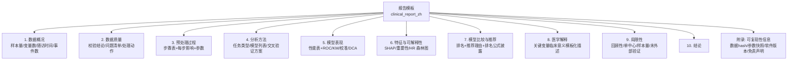
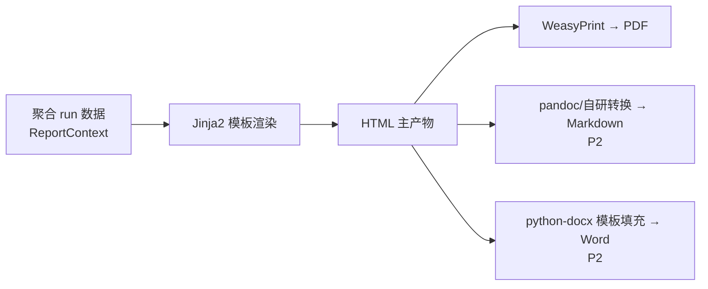

# 10. 报告系统（Report System）

> 模块 7。职责：把一次分析运行转化为**一份完整、可发表参考的中文临床分析报告**。引擎位于 `engines/reporting/`。

## 1. 模块卡片

| 项 | 内容 |
|---|---|
| 职责 | 模板渲染 → 图表装配 → 多格式导出 → 存储与下载 |
| 输入 | run_id（质量报告 + 预处理摘要 + 模型结果 + 比较结论） |
| 输出 | PDF / HTML（P0）；Markdown / Word（P2） |
| 依赖 | Jinja2、WeasyPrint（PDF）、python-docx（Word）、Plotly/matplotlib PNG |
| 接口 | `generate(run_id, format, template) -> Report`；API `POST /reports` |
| 复杂度 | 中高 |
| 风险 | WeasyPrint 系统依赖 → 仅 Linux 容器渲染；中文字体需打包（Noto Sans CJK） |

## 2. 报告结构（章节模板）

- 医学解释章节：基于变量名 + 词典生成模板化描述（如「年龄每增加 10 岁，风险比 1.21」），**明确标注由系统自动生成，需研究者核实**。
- 免责声明固定章节：「本报告由 CDAP 自动生成，仅供科研参考，不构成临床诊断建议。」

## 3. 渲染管线

- **单一事实源**：HTML 先生成，其他格式由其派生；表格/图数据与前端结果页共用 API（见 09 章）。
- 图表嵌入：分析阶段已存 PNG（S3）→ 报告装配引用，避免重复计算。
- 模板版本化：`template_key + version` 存入 Report，可复现旧报告样式。

## 4. 报告预览与交互

- 前端报告页内嵌 HTML 预览（iframe sandbox），PDF/Word 提供下载。
- 支持「重新生成」（同 run 换模板/语言）。

## 5. DoD

- [ ] 中文 PDF 渲染无缺字/乱码（Noto Sans CJK 打包进镜像）
- [ ] 10 个章节完整，缺数据章节显示「本次分析不适用」而非报错
- [ ] 报告与前端结果页数字一致（契约测试）
- [ ] 生成 10 万行数据分析的 PDF ≤ 60s
- [ ] 免责声明与可复现性附录强制存在（模板测试）
