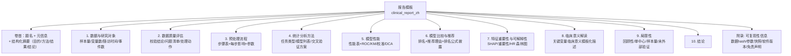
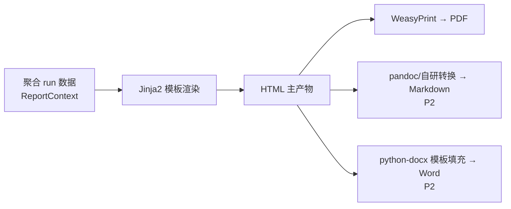

# 10. 报告系统（Report System）

> 模块 7。职责：把一次分析运行转化为**一份完整、可发表参考的中文临床分析报告**。引擎位于 `engines/reporting/`。

## 1. 模块卡片

| 项 | 内容 |
|---|---|
| 职责 | 模板渲染 → 图表装配 → 多格式导出 → 存储与下载 |
| 输入 | run_id（质量报告 + 预处理摘要 + 模型结果 + 比较结论） |
| 输出 | PDF / HTML（P0）；Markdown / Word（P2） |
| 依赖 | Jinja2、WeasyPrint（PDF）、python-docx（Word）、Plotly/matplotlib PNG |
| 接口 | `generate(run_id, format, template) -> Report`；API `POST /reports` |
| 复杂度 | 中高 |
| 风险 | WeasyPrint 系统依赖 → 仅 Linux 容器渲染；中文字体需打包（Noto Sans CJK） |

## 2. 报告结构（章节模板）

整体结构对齐医学科研期刊 IMRaD 惯例与 TRIPOD（临床预测模型报告规范）的条目顺序：
卷首（题名 + 元信息 + 结构化摘要）→ 方法（数据/质量/预处理/统计方法）→ 结果（性能/比较/可解释性）→ 讨论（解读/局限/结论）→ 附录。

- 结构化摘要四要素全部由真实计算值填充（样本量、模型清单、验证方案、Top1 推荐理由），缺失时省略对应句，禁止虚构。
- 医学解释章节：基于变量名 + 词典生成模板化描述（如「年龄每增加 10 岁，风险比 1.21」），**明确标注由系统自动生成，需研究者核实**。
- 免责声明固定章节：「本报告由 CDAP 自动生成，仅供科研参考，不构成临床诊断建议。」

### 2.3 统计增强内容（2026-08-28 补充，T6.3/T6.4）

- **基线特征表（Table 1，第 1 章）**：原始特征 + 目标分层（分类按 label、生存按 event；回归无分层），连续变量 mean±SD 或 median (Q1, Q3)（按 Shapiro-Wilk 正态性自动选择），分类变量 n (%)；分层时附组间差异 p 值（t 检验/Mann-Whitney/ANOVA/Kruskal/χ²/Fisher，自动按变量类型与正态性选择）。
- **性能表 p 值列（第 5 章，T6.4）**：性能表按 comparison.ranking 排序，首行标注「参考」，其余模型给出与最佳模型主指标（分类 AUC / 回归 RMSE / 生存 C-index）折级配对 t 检验 p 值（\* \<0.05、\*\* \<0.01、\*\*\* \<0.001），表下附方法学说明。
- **回归诊断（第 5 章，回归任务）**：训练阶段持久化各模型 OOF 预测（`runs/{id}/oof_{model}.parquet`），报告时基于推荐模型 OOF 残差计算 Shapiro-Wilk 正态性、Breusch-Pagan 同方差性、Durbin-Watson 自相关检验与 VIF 多重共线性，并在预处理特征空间拟合全量 OLS 给出系数表（β、95% CI、p 值）；诊断结论同步进入第 8 章解读。
- **分类校准（第 5 章，二分类任务）**：基于推荐模型 OOF 概率计算 Hosmer-Lemeshow 校准度检验与 Youden 最优阈值（灵敏度/特异度），结论同步进入第 8 章。
- 上述内容全部来自真实计算；对应产物缺失时章节降级为「不适用」或省略，不阻断报告生成。

### 2.1 排版与图表规范（2026-08-10 修订）

- **每图必带图题**：编号（图 1、图 2…）+ 标题 + 一段说明（这张图展示什么、怎么读、对研究问题的意义），按 kind 集中维护文案（`reporting/captions.py`），HTML/PDF/Word/Markdown 四格式一致输出。
- **每表必带表题**：编号（表 1、表 2…）+ 标题，置于表**上方**（医学期刊惯例），全文连续编号。
- **排版取向**：参照 NEJM/Lancet/JAMA——正文衬线（Noto Serif CJK）、标题无衬线深色、三线表（仅横线）、图题小号字置于图下；`@page` 页眉为短标题（首页无页眉）、页脚「第 X 页 / 共 Y 页」；整体克制留白，商务简约。
- **PNG 图表字体**：matplotlib 首选 Noto Sans CJK SC（容器已打包），特征名等用户原文标签可直接中文渲染，无缺字方块；坐标轴/图例保留英文术语惯例。

### 2.2 HTML 交互折叠（2026-08-10 补充）

- HTML 产物中重点表（变量概况/质量问题/预处理步骤/模型性能/附录）默认折叠为 `
/
`（＋/－ 指示，无 JS 依赖，sandbox iframe 内可用），点击展开；PDF/Word/Markdown 派生物始终全展开。
- 渲染入口 `render_html(context, collapsible=False)`：仅 `format=html` 时传 True，派生格式共用非折叠主产物。

## 3. 渲染管线

- **单一事实源**：HTML 先生成，其他格式由其派生；表格/图数据与前端结果页共用 API（见 09 章）。
- 图表嵌入：分析阶段已存 PNG（S3）→ 报告装配引用，避免重复计算。
- 模板版本化：`template_key + version` 存入 Report，可复现旧报告样式。

## 4. 报告预览与交互

- 前端报告页内嵌 HTML 预览（iframe sandbox），PDF/Word 提供下载。
- 报告产物上传须按格式设置 Content-Type（html → `text/html; charset=utf-8`、pdf → `application/pdf` 等，2026-08-10 补充）：预览 iframe 依赖浏览器按 MIME 渲染，缺失会导致白屏/强制下载。
- 支持「重新生成」（同 run 换模板/语言）。

## 5. DoD

- [ ] 中文 PDF 渲染无缺字/乱码（Noto Sans CJK 打包进镜像）
- [ ] 10 个章节完整，缺数据章节显示「本次分析不适用」而非报错
- [ ] 报告与前端结果页数字一致（契约测试）
- [ ] 生成 10 万行数据分析的 PDF ≤ 60s
- [ ] 免责声明与可复现性附录强制存在（模板测试）
