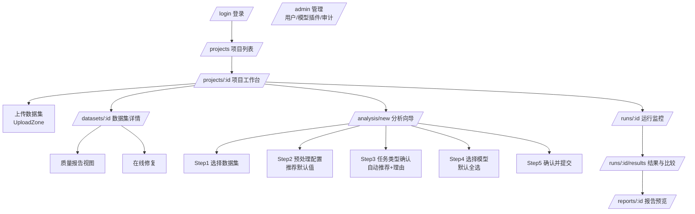

# 11. 前端设计（Frontend Design）

> React 18 + TypeScript + Vite + Ant Design 5 + ECharts + Zustand + React Router + openapi-typescript 生成客户端。

## 1. 页面地图

## 2. 关键页面设计

### 2.1 上传与质量报告

- `UploadZone`：拖拽 + 批量 + 进度条；>50MB 分片（P2）。
- 上传完成自动跳转质量报告页：
  - 顶部：状态横幅（绿色通过 / 黄色 N 个警告 / 红色 N 个阻塞，阻塞时「开始分析」按钮禁用）
  - 中部：问题清单表格（级别/列/问题/影响行数/建议/一键修复按钮）
  - 底部：列画像（每列类型、缺失率、分布迷你图）
- 一键修复弹出影响预览（「将删除 521 行中的 12 行重复记录」）→ 确认生成新版本。

### 2.2 分析向导（核心体验）

| 步骤 | 内容 | 默认值策略 |
|---|---|---|
| 1 数据集 | 选择项目内已校验数据集 | 最近使用 |
| 2 预处理 | 步骤开关 + 参数（手风琴面板） | 「推荐配置」已填充，可整体重置 |
| 3 任务类型 | 卡片式展示推荐结果 + 置信度 + 理由，可切换 | 自动推荐项默认选中 |
| 4 模型 | 按任务类型过滤的模型多选，标注预计耗时 | 全选 |
| 5 确认 | 全参数摘要 + 预计总耗时 → 提交 | — |

### 2.3 运行监控

- 轮询 `/progress`（2s 间隔）或 SSE。
- 可视化：总进度条 + 每模型状态芯片（排队/运行/成功/失败 + 失败原因 tooltip）。
- 失败呈现（2026-08-05 补充）：运行失败时，错误 Alert 除 run.error 外须**直接列出每个失败模型的错误信息**（progress.errors 逐项），不允许只给「全部模型失败」这类无信息量文案；tooltip 仅作补充。
- 操作：取消、失败后重试。

### 2.4 结果与比较页

- Tab1 性能表：可排序表格，Top3 奖牌标注 + 推荐理由卡片。
- Tab2 图表：ROC 叠加/校准/DCA/混淆矩阵/KM（ECharts，工具箱支持导出 PNG）。
- Tab3 可解释性：SHAP 摘要、特征重要性、HR 森林图。
- Tab4 各模型详情：每模型指标 + 失败模型的错误信息 + 「重跑此模型」。
- 顶部固定操作：「生成报告」→ 选格式/模板 → 跳转报告预览。

### 2.5 报告页

- iframe HTML 预览（sandbox）+ 下载按钮（PDF/HTML）。
- 历史报告列表（同 run 多版本）。

## 3. 组件清单

| 组件 | 职责 |
|---|---|
| UploadZone | 拖拽/批量/进度 |
| QualityReportPanel | issues 表格 + 画像 + QuickFix |
| ColumnProfileGrid | 列画像卡片 |
| PreprocessConfigurator | DSL 可视化编辑（受控表单，输出 JSON） |
| TaskTypeRecommender | 推荐卡片 + 置信度 + 覆盖 |
| ModelSelector | 模型多选 + 能力标签（SHAP/校准） |
| RunProgressBoard | 进度条 + 模型状态芯片 |
| MetricsTable | 性能表（排序/高亮 Top3） |
| ChartPanel | ECharts 封装（roc/dca/km/shap） |
| ReportViewer | iframe 预览 + 下载 |

## 4. 状态与 API 约定

- Zustand store：`useProjectStore / useRunStore`；服务端状态用 TanStack Query（缓存+轮询）。
- 所有 API 调用走 `openapi-typescript` 生成的类型化客户端；错误码统一 toast（错误码见 14 章）。
- 路由守卫：未登录 → /login；viewer 角色隐藏「提交分析/修复」按钮。

## 5. 交互与可用性要求

- 界面支持简体中文（`zh-CN`）与英文（`en`）；首次访问按 `localStorage → navigator` 检测，未知语言回退中文，仅用户主动切换才持久化 `cdap.locale`。
- 所有异步操作有 loading 与空状态；AntD、dayjs、ECharts、日期/数字和 HTML `lang/title` 必须随语言同步。
- 表单 value、DSL、模型/任务/状态枚举和兼容旧后端的业务字符串不得随 UI 翻译改变。
- T9.1–T9.3 仅覆盖前端静态文案；后端动态文本与报告产物在 T9.4–T9.6 完成前保持原语言，不得在前端机器翻译。
- 点击到报告路径 ≤ 6 步（验收指标 G1）。
- 表单变更即校验（Pydantic schema 同源生成 zod schema，P2）。

## 6. 视觉语言（2026-08-10，anti-ui-slop 设计契约）

> 方法论：先定契约再排版（屏幕职责 → 用户 → 主动作 → 状态 → 拒绝清单），美学方向一次性选定并全站执行。

**屏幕职责与主动作**

| 屏幕 | 职责 | 主动作 |
|---|---|---|
| /login | 建立「严肃科研工具」的第一信任 | 登录 |
| /projects | 找到并进入项目 | 新建项目 |
| /projects/:id | 项目工作台（数据集/运行入口） | 上传数据集 / 新建分析 |
| 向导/监控/结果 | 完成分析闭环 | 下一步 / 生成报告 |

**目标用户**：医学研究者——对印刷级精确、数据可溯源有天然信任，对花哨装饰天然警惕。

**美学方向：学术编辑风（editorial / scientific journal）**——与报告排版（docs/10 §2.1）同源，品牌记忆点是「界面即期刊」：

- 字体：标题衬线（Noto Serif SC / Source Han Serif SC / STSong 本地栈，**不引外部字体 CDN**，离线可用）；正文系统无衬线（PingFang SC / Microsoft YaHei）；数字 `font-variant-numeric: tabular-nums`。
- 色彩：墨黑 `#1a1a1a`、藏青 `#1f4e79`（主色）、纸白 `#faf9f6`（微暖底色，区别于通用灰）、hairline 分隔线 `#e3e0d8`。
- 细节：hairline 细线框替代厚重卡片阴影；eyebrow 小标签（中文小标题 + 宽字距）；页首题名 + 细分隔线；动效仅克制入场淡入（≤300ms）。
- 拒绝清单（评审时逐项检查）：装饰性渐变/玻璃拟态/发光、通用 dashboard 卡片墙、假数据与占位指标、模糊标签（「概览」「了解更多」）、Inter/Roboto/Arial、桌面布局硬压到移动端。
- 状态覆盖：每屏必须有 loading / empty / error / 权限四态，且真实可达。

**Finish gate**（每次前端改动自查）：屏幕目的一眼可见；主动作统领层级；每个控件有真实结果；文案属于本产品；四态已实现；响应式是有意设计；不违反本节 token。

## 7. DoD

- [ ] 三个验收场景（01 章场景 A/B/C）可完整走通
- [ ] 阻塞级问题正确禁用分析入口
- [ ] 结果页与报告数据一致（同一 API）
- [ ] Chrome/Edge 最新两版无控制台错误
- [ ] 视觉语言符合 §6 设计契约（finish gate 逐项过）
