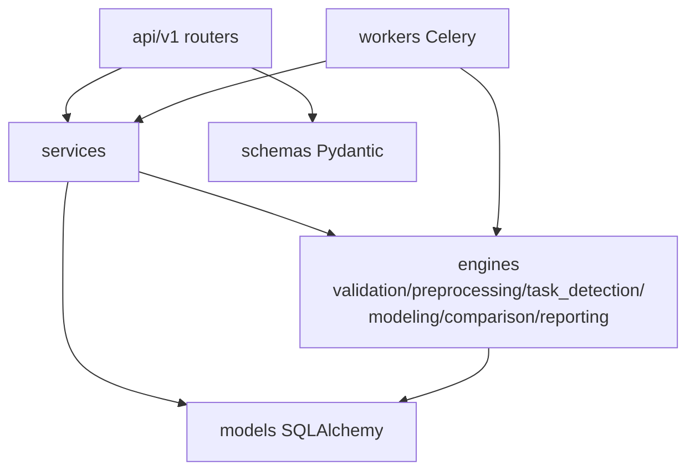

# 12. 后端设计（Backend Design）

## 1. 分层与依赖规则



**依赖规则（ArchUnit 式，CI 用 import-linter 强制）**：
1. `engines/*` 不得 import `fastapi`、`sqlalchemy.orm.Session`（除类型注解）、`celery`。
2. `api/*` 不得直接操作 ORM，必须经 services。
3. `workers/*` 只做参数解包 → 调 engines/services → 落库，不含业务规则。

## 2. 核心组件

### 2.1 配置（core/config.py）

Pydantic Settings，环境变量驱动：`DATABASE_URL / REDIS_URL / S3_ENDPOINT / S3_BUCKET / JWT_SECRET / MODEL_TIMEOUT_S / MAX_UPLOAD_MB / LOG_LEVEL`。分 `Settings(BaseSettings)` + `.env` 本地覆盖；禁止代码内硬编码默认值之外的密钥。

**生产密钥强制（T8.4）**：`ENVIRONMENT=prod` 时若 `JWT_SECRET` 仍为开发默认值，应用启动即拒绝
（fail-fast，防「默认密钥上线」）；`ENVIRONMENT` 缺省为 `dev`（本地/测试不受影响）。

### 2.2 鉴权（core/security.py）

- 登录：`POST /auth/login` → JWT access(2h) + refresh(7d)。
- 密码：BCrypt。
- RBAC：`admin / researcher / viewer`，依赖注入 `require_role("researcher")`。
- 项目隔离：所有 project-scoped 查询强制 `owner_id == current_user.id`（admin 除外），service 层统一封装，防越权。

### 2.3 异常体系（core/errors.py）

```python
class AppError(Exception):
    code: str        # "DATASET_NOT_FOUND"
    status: int      # 404
    message: str     # 用户可读(中文)
    details: dict
```

全局 handler → RFC7807 响应：`{"code","message","details","trace_id"}`。错误码全集见 [14-API-Specification](14-API-Specification.md)。

### 2.4 存储抽象（services/storage.py）

```python
class StorageBackend(Protocol):
    def put(self, key: str, data: BinaryIO) -> str: ...
    def get(self, key: str) -> bytes: ...
    def presign_download(self, key: str) -> str: ...
```

实现：`S3Storage`(MinIO/生产) + `LocalStorage`(单测/开发)。**业务代码只依赖协议**，未来迁云零改动。

> 预签名 URL 的可达性（2026-08-03 补充）：`presign_download` 的返回 URL 最终由**浏览器**直接访问（报告下载 302，14 章）。容器网络内端点（如 `http://minio:9000`）浏览器不可解析，故 `S3Storage` 支持 `S3_PUBLIC_ENDPOINT`：**SigV4 签名将 host 计入签名，事后改写 URL 会 403**，因此用该公开端点构造独立的预签名客户端（指定 `region=us-east-1` 跳过服务端 region 探测，预签名为纯本地计算）；docker-compose 须相应发布 MinIO API 端口（默认 `localhost:9000`）。

### 2.5 文件上传

- multipart → 流式写 S3（不落 API 服务器磁盘）。
- 校验：扩展名白名单（.csv/.xlsx/.xls/.tsv/.txt）、大小上限（默认 200MB）、magic bytes 嗅探（防伪装）。
- 大文件分片（P2）：S3 multipart 直通。

### 2.6 审计（services/audit.py）

中间件 + service 显式埋点：登录、上传、删除、提交分析、导出报告 → `AUDIT_LOG`（见 04 章）。

## 3. Celery 任务设计

| 任务 | 队列 | 幂等性 | 重试 |
|---|---|---|---|
| `validate_dataset` | default | 重复执行覆盖同 version 报告 | 自动 ×2 |
| `preprocess` | default | run_id 唯一键，重复提交拒绝 | 手动 |
| `run_model` | model | (run_id, model_key) 唯一约束 | 手动/单模型重跑 |
| `compare` | default | 重算覆盖 comparison | 自动 ×1 |
| `generate_report` | report | (run_id, format, template, created_by) 去重 | 自动 ×1 |
| `janitor`（beat 每 5min） | default | 扫描超时 RUNNING → FAILED | — |

Worker 配置：`task_acks_late=True`、`worker_prefetch_multiplier=1`（长任务公平调度）、`task_time_limit=MODEL_TIMEOUT_S`。

## 4. 日志与可观测

- structlog JSON：`trace_id`(API 生成) → `run_id` 贯穿 worker 任务头。
- 健康检查：`/healthz`(活)、`/readyz`(DB/Redis/S3 连通)。
- 指标（P2）：Prometheus `/metrics`（任务耗时、失败率、队列深度）。

## 5. 性能设计

- API 全异步（async def + async SQLAlchemy）；CPU 密集工作只允许在 worker。
- 数据集预览：上传时即生成前 100 行预览 JSON 存 PG，详情页秒开。
- 列画像与校验在 worker 分块计算。
- DB 索引设计见 13 章；列表接口全部分页（cursor）。

## 6. 测试策略衔接

- 引擎层：纯单测（无 IO 或 LocalStorage）。
- service 层：testcontainers（PG/Redis/MinIO）集成测试。
- API 层：httpx + dependency override。
- 详见 [19-Test-Plan](19-Test-Plan.md)。
