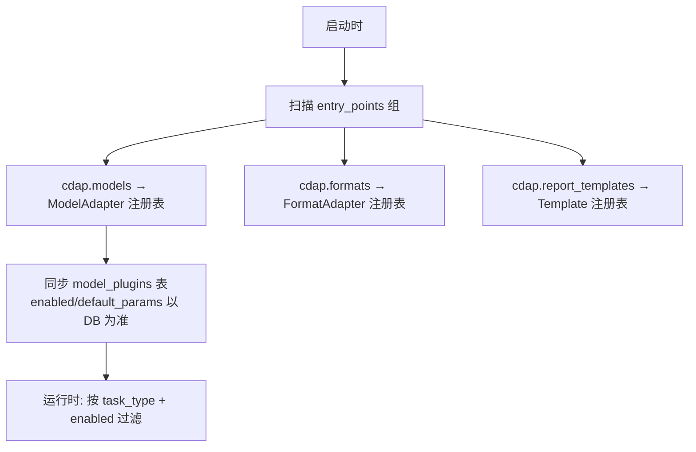

# 15. 插件系统（Plugin System）

> 三类插件点：**模型插件**（P0）、**数据格式插件**（P1）、**报告模板插件**（P1）。目标：新增能力不改核心代码。

## 1. 总体机制



- 加载机制：Python `importlib.metadata.entry_points(group="cdap.models")`。
- 内置模型即以插件形式实现（`backend/app/plugins/builtin/`），**核心不特殊对待内置**——这本身就是插件机制的验收。
- DB `model_plugins` 表存运行时状态（enabled、默认参数覆盖）；代码实现来自 entry point。

## 2. 模型插件协议

```python
# pyproject.toml（插件包）
[project.entry-points."cdap.models"]
my_model = "my_pkg.my_model:MyModelAdapter"
```

适配器协议见 [07-ML-Model-Management](07-ML-Model-Management.md#2-模型适配器协议)。插件注册时声明：

```python
key = "gbs_aft"
name = "Gradient Boosted AFT"
version = "0.1.0"
task_types = ["survival"]
capabilities = {"shap": True, "calibration": True}
default_params = {"n_estimators": 200, "learning_rate": 0.05}
```

注册校验（启动时，失败拒绝加载并告警）：
- `key` 全局唯一、匹配 `^[a-z][a-z0-9_]{1,40}$`
- 实现全部协议方法（`inspect.signature` 校验）
- `task_types` 合法子集

## 3. 数据格式插件

```python
class FormatAdapter(Protocol):
    key: str                     # "fhir"
    file_types: list[str]        # [".json"]
    def sniff(self, head: bytes) -> float: ...     # 0-1 置信度
    def to_dataframe(self, uri: str) -> DataFrame: ...
```

v1 内置 `csv`、`excel`；`fhir`、`omop` 作为未来插件（见 22 章）。上传时按 `sniff` 置信度选适配器，用户可覆盖。

## 4. 报告模板插件

- 模板包 = Jinja2 模板目录 + `template.yaml`（key/name/version/语言/章节开关）。
- 存放：`backend/app/plugins/templates/`（内置）或管理员上传目录（P2）。
- 报告生成时按 `template_key` 解析。

## 5. 安全约束

| 约束 | 说明 |
|---|---|
| 仅 admin 可安装第三方插件包 | 通过 pip 安装到 worker 镜像，**不提供运行时代码上传执行**（RCE 风险） |
| 插件在 worker 进程内运行 | 受 task_time_limit 限制；崩溃不影响其他模型任务 |
| 参数校验 | 用户覆盖参数经插件声明的 JSON Schema 校验后才传入 fit |
| 版本固定 | 插件版本随镜像锁定，升级走发布流程 |

## 6. 管理界面

`/admin/plugins`：列表（名称/版本/支持任务/能力/启用开关/默认参数编辑 JSON）；禁用后新 run 不可选，历史 run 结果不受影响（结果已落库）。

## 7. DoD

- [ ] 13 个内置模型全部经 entry_points 注册（核心无 if/else 硬编码模型）
- [ ] 外部 dummy 插件包 pip 安装后重启即被发现并可运行
- [ ] 非法插件（缺方法/重 key）启动拒绝且有明确日志
- [ ] 禁用插件后提交分析返回 400 且 UI 过滤
