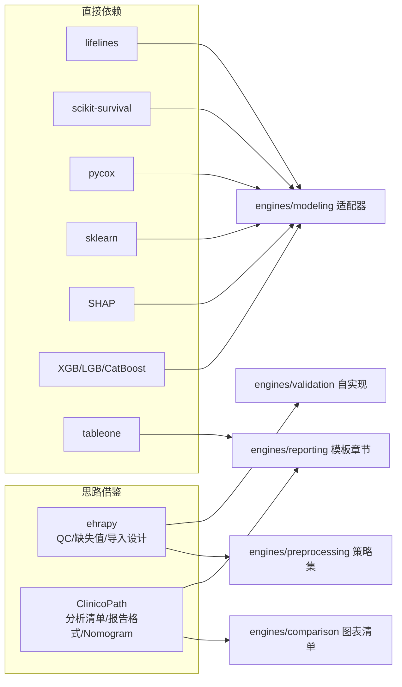

# 16. GitHub 开源项目调研（Phase 2）

> 原则：优先复用成熟项目，不重造轮子。结论先行：**ehrapy 复用思想与部分模块，ClinicoPath 复用分析清单与报告结构，运行时主力库为 lifelines/scikit-survival/pycox/sklearn 等。**

## 1. theislab/ehrapy

- 仓库：`theislab/ehrapy`（Python，基于 anndata/scanpy 生态）
- 定位：EHR 数据分析框架（导入→质控→预处理→ML→生存→可视化）

### 1.1 模块逐项评估

| ehrapy 模块 | 功能 | 评估 | 本项目处置 |
|---|---|---|---|
| Data Import (`ep.io`) | CSV/TSV/PDF/FHIR 读取 → AnnData | 思路好；AnnData 对本项目过重（我们面向宽表 CSV） | **借鉴接口设计**，不直接依赖 |
| EHR Processing / QC | 缺失模式、列类型推断、QC 指标 | 质量画像思路与指标定义成熟 | **复用思路**，在 `engines/validation` 自实现（pandas 原生） |
| Data Cleaning / Missing Value | 删除/均值/中位数/众数/KNN/多重插补 | 策略全集可参考 | 复用策略清单；实现用 sklearn Imputer（见 06 章） |
| Encoding / Normalization | one-hot/label、log1p/scale | 标准 | sklearn 实现 |
| Feature Engineering | 临床特征派生 | 参考价值中 | DSL derive 步骤 |
| ML Pipeline | 基于 sklearn 的封装 | 薄封装 | 不自建依赖，直接用 sklearn |
| Survival Analysis | 依赖 lifelines | 即 lifelines 转调 | **直接用 lifelines** |
| Risk Prediction | 封装 sklearn | 薄封装 | 自实现适配器 |
| Visualization | QC/EDA 图 | 图表选题可参考 | 前端 ECharts + Plotly 自绘 |

### 1.2 结论

- **直接复用**：无（避免拖入 anndata 重依赖）。
- **二次开发参考**：QC 指标定义、缺失值策略全集、列类型推断规则、FHIR 导入设计（22 章）。
- **不适合**：AnnData 数据模型（为单细胞设计，对临床宽表是负担）。

## 2. sbalci/ClinicoPathJamoviModule

- 仓库：`sbalci/ClinicoPathJamoviModule`（R / jamovi 模块）
- 定位：临床病理研究一站式统计分析（面向非编程用户的 GUI 统计分析，与本品理念一致）

### 2.1 分析模块评估

| 模块 | 价值 | 本项目处置 |
|---|---|---|
| Survival Analysis（KM/log-rank） | 图表规范与输出格式极佳 | **借鉴输出格式**；计算用 lifelines |
| Cox Regression | HR 表 + 森林图 + 比例风险假设检验 | 借鉴输出结构（HR 表/森林图/PH 检验）；lifelines 实现 |
| ROC / 最佳截断（Youden） | 临床报告必备 | 纳入 comparison 图表清单（v1 提供 ROC；最佳截断 P1） |
| Logistic Regression | OR 表输出格式 | 借鉴 |
| Nomogram（列线图） | 临床论文高频需求 | **P2 纳入**（生存/逻辑回归的 nomogram 图） |
| Descriptive Statistics | Table 1（基线特征表） | **借鉴：报告第 1 章加入「基线特征表（Table 1）」**——这是对原需求的增强 |
| Clinical Report 输出 | 结构化统计报告模板 | 借鉴章节组织方式到 10 章模板 |

### 2.2 结论

- **直接复用**：无（R 生态，与 Python 技术栈不同；jamovi 耦合重）。
- **值得借鉴**：分析清单完整性（Table 1、Nomogram、最佳截断）、统计输出的临床表达格式（HR/OR 表、森林图、PH 假设检验呈现）。
- **集成方式**：作为「报告与图表规范」参考，Python 侧用 lifelines/statsmodels 实现。

## 3. 补充推荐项目（优于上两者之处）

| 项目 | 用途 | 为什么采用 |
|---|---|---|
| **lifelines** (CamDavidsonPilon/lifelines) | KM/CoxPH/AFT/PH 检验 | Python 生存分析事实标准；ehrapy 底层也是它——直接用它少一层封装 |
| **scikit-survival** (sebp/scikit-survival) | RSF/GBS/C-index/IBS | sklearn API 兼容，与预处理 Pipeline 无缝；C-index/IBS 官方实现避免自算错误 |
| **pycox** (havakv/pycox) | DeepSurv | 最成熟实现，免去自研神经网络生存模型 |
| **SHAP** (shap/shap) | 可解释性 | 事实标准，TreeExplainer 覆盖 XGB/LGB/CatBoost/RF |
| **dcurves** (MSKCC/dcurves) | 决策曲线分析 | DCA 公式易错，专门库更稳（备选：按论文公式自实现+测试） |
| **pandera** | DataFrame 校验 | 声明式 schema，补充自研规则引擎 |
| **tableone** (tompollard/tableone) | 基线特征表 | 直接生成临床 Table 1，对应 ClinicoPath 的 Descriptive 模块 |

## 4. 复用决策汇总

## 5. 许可证核查（编码前必须确认）

| 项目 | 许可证（需编码时复核） | 商用/院内使用 |
|---|---|---|
| lifelines | MIT | ✅ |
| scikit-survival | GPL-3.0 | ⚠️ 动态链接/独立进程使用可接受；作为库 import 需评估——**缓解：若严格合规场景，用 sksurv 独立 worker 进程隔离或替换实现** |
| pycox | BSD-2 | ✅ |
| SHAP | MIT | ✅ |
| XGBoost/LightGBM/CatBoost | Apache-2.0/MIT/Apache-2.0 | ✅ |
| tableone | MIT | ✅ |
| ehrapy | BSD-3 | ✅（仅参考不依赖） |

> ~~行动项（进入编码阶段前）：跑 `pip-licenses` 生成完整依赖许可证清单并评审。~~
> **已完成（2026-07-29）**：完整双审计（漏洞 + 许可证）见 [licenses-report.md](licenses-report.md)。关键结果：ecos(GPLv3) 由 scikit-survival 拖入，与其绑定决策；python-jose 因 ecdsa 无修复漏洞更换为 PyJWT；starlette CVE 修复线与 fastapi 不兼容，豁免 + 缓解措施已登记。
