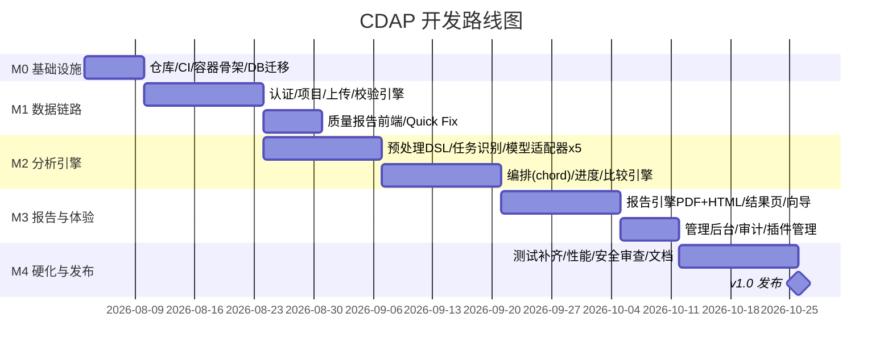

# 17. 开发路线图（Development Roadmap）

## 1. 里程碑总览



## 2. 里程碑定义与出口标准

| 里程碑 | 范围 | 出口标准（DoD 摘要） |
|---|---|---|
| **M0 基础设施**（1w） | monorepo、CI（lint/test/build）、docker-compose 骨架、Alembic 初始化、pre-commit | `docker compose up` 拉起空 API+前端壳；CI 绿 |
| **M1 数据链路**（3w） | 认证 RBAC、项目 CRUD、上传（编码嗅探/预览）、校验引擎 18 规则、质量报告页、Quick Fix | 场景 B（坏数据）走通；校验性能 ≤30s/10w 行 |
| **M2 分析引擎**（4w） | 预处理 DSL 7 步骤、任务识别、5 模型适配器（coxph/rsf/logreg/lightgbm/rf）、chord 编排、进度、比较引擎 | 场景 A/C 在 API 层走通（无前端也可跑）；泄漏测试过 |
| **M3 报告与体验**（3w） | 报告引擎（PDF/HTML）、结果比较页、分析向导、模型补齐 13 个、管理后台、插件管理 | 端到端 ≤6 点击；PDF 中文无缺字；免责声明强制 |
| **M4 硬化与发布**（2w） | 测试覆盖率补齐、性能压测、安全审查、部署文档、用户手册 | 项目级 DoD（00 章 §3）全部满足 |

## 3. 并行策略

- M1 起，前端与后端并行：API 契约（14 章）先行冻结，前端用 mock server（MSW）开发。
- M2 中「预处理 DSL」与「模型适配器」可两人并行；「比较引擎」依赖统一 metrics，需在适配器接口冻结后启动。
- 报告模板设计可与 M2 并行（输入契约 = 04 章 JSONB 结构）。

## 4. 版本规划

| 版本 | 内容 |
|---|---|
| v0.5（M2 末） | API 可跑通全链路，内部试用 |
| v0.9（M3 末） | 功能完整，候选发布 |
| v1.0（M4 末） | 正式发布 |
| v1.1（规划） | Word/Markdown 报告、Nomogram、Table 1 增强、SSE |
| v2.0（规划） | FHIR/OMOP、MCP Server、预测 API、K8s 多租户（见 22 章） |

## 5. 依赖关键路径

```
契约冻结(14章) → M1上传校验 → 预处理DSL → 适配器协议 → chord编排 → 比较引擎 → 报告引擎 → 硬化
```
任务识别可并行；前端各页面依赖对应 API 契约即可并行。
