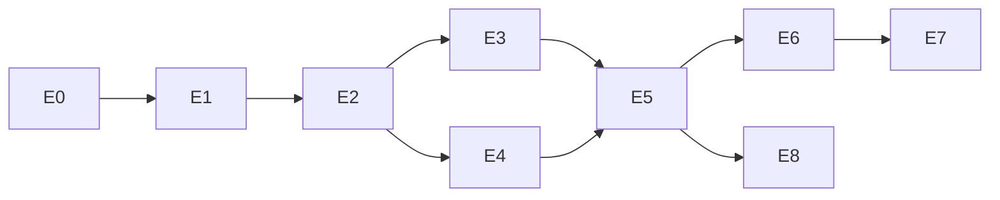

# 18. 任务拆分（Task Breakdown）

> Epic → Feature → Task → Subtask。工时单位：人日（d）。优先级：P0/P1/P2。每个 Task 给出 DoD 与验收标准；Subtask 级测试方案汇总到各 Task「测试」行。

## Epic E0 — 基础设施（M0）

| Task | 工时 | 优先级 | 依赖 | 并行 | DoD / 验收标准 |
|---|---|---|---|---|---|
| T0.1 monorepo 骨架 + pre-commit（ruff/mypy） | 1 | P0 | — | ✅ | `ruff check`/`mypy` CI 绿；提交即触发 hook |
| T0.2 CI（GitHub Actions：lint/test/build/镜像） | 1 | P0 | T0.1 | ✅ | PR 必过 CI；镜像构建产物推送 |
| T0.3 docker-compose 骨架（api/worker/pg/redis/minio/frontend） | 1 | P0 | — | ✅ | `docker compose up` 全绿，`/healthz` 200 |
| T0.4 Alembic + 初始迁移（13 章全部表） | 1 | P0 | T0.3 | ✅ | upgrade/downgrade 各跑一次成功；表与 DDL 一致 |
| T0.5 配置/日志/异常/存储抽象（12 章 §2.1/2.3/2.4） | 1 | P0 | T0.1 | ✅ | 单测覆盖；S3/Local 双实现可切换 |

## Epic E1 — 认证与项目（M1）

| Task | 工时 | 优先级 | 依赖 | 并行 | DoD / 验收标准 |
|---|---|---|---|---|---|
| T1.1 用户模型 + 注册/登录/JWT 刷新 | 2 | P0 | T0.4 | ✅ | 登录返回 token；过期 401；密码 BCrypt；单测+API 测试 |
| T1.2 RBAC + 项目级隔离 | 1 | P0 | T1.1 | ✅ | viewer 调写接口 403；越权访问他人项目 404；集成测试 |
| T1.3 项目 CRUD API + 前端项目列表页 | 2 | P0 | T1.1 | 前后端并行 | 契约一致；页面可建/列/删（软删） |
| T1.4 审计日志埋点（登录/删除/提交/导出） | 1 | P1 | T1.1 | ✅ | audit_logs 有记录且含 actor/资源 |

## Epic E2 — 数据导入与校验（M1）

| Task | 工时 | 优先级 | 依赖 | 并行 | DoD / 验收标准 |
|---|---|---|---|---|---|
| T2.1 上传 API（流式 S3、白名单、大小限制、magic 嗅探） | 2 | P0 | T0.5, T1.2 | ✅ | 非法类型 400；>上限 413；上传后 status=VALIDATING 且任务入队 |
| T2.2 解析器：编码/分隔符/表头嗅探 + 预览生成 | 2 | P0 | T2.1 | ✅ | UTF-8/GBK/GB18030 样例全部解析正确；preview 100 行入库 |
| T2.3 列类型推断 + 语义识别词典 | 2 | P0 | T2.2 | ✅ | 词典内列名识别率 100%；输出 semantic+confidence |
| T2.4 校验规则引擎（13 规则，05 章 §3 目录为准） | 4 | P0 | T2.3 | 可拆 2 人 | 每规则单测正反例；报告 JSON 契约符合 14 章 |
| T2.5 质量报告 API + 前端质量报告页 | 3 | P0 | T2.4 | 前后端并行 | 阻塞禁用分析入口；一键修复按钮按级别显示 |
| T2.6 Quick Fix（4 动作 + 新版本生成） | 2 | P0 | T2.5 | ✅ | 修复产生新 version；原文件不变；影响预览准确 |
| T2.7 校验性能（分块读取） | 1 | P1 | T2.4 | ✅ | 10w 行 ≤30s（性能测试记录） |

## Epic E3 — 预处理（M2）

| Task | 工时 | 优先级 | 依赖 | 并行 | DoD / 验收标准 |
|---|---|---|---|---|---|
| T3.1 流水线 DSL schema + 校验（Pydantic） | 1 | P0 | — | ✅ | 非法 DSL 400；schema 文档化（06 章） |
| T3.2 步骤实现：missing/outlier/encode/scale | 3 | P0 | T3.1 | ✅ | 各步骤单测；sklearn Pipeline 兼容 |
| T3.3 步骤实现：feature_select/derive（白名单表达式） | 2 | P0 | T3.1 | ✅ | derive 拒绝任意代码执行（安全测试） |
| T3.4 防泄漏 + Snapshot + 可重放 | 2 | P0 | T3.2 | ✅ | 泄漏断言测试；两次运行特征矩阵逐位相等 |
| T3.5 推荐默认配置生成器 | 1 | P0 | T2.3, T3.2 | ✅ | 对测试数据生成的 DSL 可直接运行成功 |
| T3.6 前端预处理配置面板 | 2 | P0 | T3.1 | 前端并行 | 表单 ↔ DSL 双向同步；「推荐配置」一键填充 |

## Epic E4 — 任务识别（M2）

| Task | 工时 | 优先级 | 依赖 | 并行 | DoD / 验收标准 |
|---|---|---|---|---|---|
| T4.1 识别规则引擎（时间/事件/标签候选 + 置信度） | 2 | P0 | T2.3 | ✅ | 4 类任务各 ≥3 用例；失败路径返回 422 |
| T4.2 detect-task API + 前端确认卡片 | 1 | P0 | T4.1 | 前后端并行 | 推荐理由展示；用户覆盖后随 run 快照保存 |

## Epic E5 — 模型与分析编排（M2）

| Task | 工时 | 优先级 | 依赖 | 并行 | DoD / 验收标准 |
|---|---|---|---|---|---|
| T5.1 ModelAdapter 协议 + entry_points 注册表 + DB 同步 | 2 | P0 | T0.4 | ✅ | dummy 插件零改动注册；非法插件拒绝加载 |
| T5.2 统一 metrics 模块（3 任务类型） | 2 | P0 | — | ✅ | 与 lifelines/sksurv 官方实现对拍一致（±1e-6） |
| T5.3 生存适配器：km/coxph/rsf/gbs | 3 | P0 | T5.1, T5.2 | ✅ | 各跑通示例数据；指标落库结构正确 |
| T5.4 分类适配器：logreg/rf/svm/xgboost/lightgbm/catboost | 3 | P0 | T5.1, T5.2 | 可与 T5.3 并行 | 同上；概率输出用于校准 |
| T5.5 回归适配器：lasso/elasticnet/rf/xgboost | 1 | P1 | T5.1, T5.2 | ✅ | 同上 |
| T5.6 DeepSurv（pycox, CPU） | 2 | P1 | T5.1 | ✅ | CPU 训练完成；超时保护生效 |
| T5.7 SHAP/重要性/图表产物 | 2 | P0 | T5.3, T5.4 | ✅ | 树模型出 SHAP 摘要；Cox 出 HR 森林图数据 |
| T5.8 Celery 编排 chain+chord + 状态机 + 进度 | 3 | P0 | T5.3, T3.4 | ✅ | 集成测试：N 模型并行→回调→COMPLETED；进度百分比正确 |
| T5.9 取消/重试/单模型重跑 + janitor | 2 | P0 | T5.8 | ✅ | kill -9 注入后任务可恢复；取消即时生效 |
| T5.10 运行监控页（进度板） | 2 | P0 | T5.8 | 前端并行 | 状态芯片/进度条/失败原因 tooltip |

## Epic E6 — 模型比较（M2-M3）

| Task | 工时 | 优先级 | 依赖 | 并行 | DoD / 验收标准 |
|---|---|---|---|---|---|
| T6.1 性能表聚合 + comparison API | 1 | P0 | T5.2, T5.8 | ✅ | 契约符合 14 章；失败模型标注 |
| T6.2 对比图表数据：ROC/校准/DCA/混淆/KM/C-index 森林图 | 3 | P0 | T6.1 | 可拆 | 图表数据 JSON 与报告 PNG 同源 |
| T6.3 排名 + 推荐理由模板引擎 | 1 | P0 | T6.1 | ✅ | 排名规则单测；理由只引用真实指标（快照测试） |
| T6.4 结果比较页（4 Tab） | 3 | P0 | T6.2 | 前端并行 | 11 章 §2.4 全部交互可用 |

## Epic E7 — 报告（M3）

| Task | 工时 | 优先级 | 依赖 | 并行 | DoD / 验收标准 |
|---|---|---|---|---|---|
| T7.1 ReportContext 聚合器 | 1 | P0 | T6.1 | ✅ | 缺章节数据时标记「不适用」 |
| T7.2 Jinja2 中文模板（10 章结构 + Table 1 + 免责声明） | 3 | P0 | T7.1 | 可与引擎并行 | 模板测试：免责声明与可复现附录强制存在 |
| T7.3 HTML 渲染 + 图表装配 | 1 | P0 | T7.2 | ✅ | 数字与 comparison API 一致（契约测试） |
| T7.4 WeasyPrint PDF（中文字体打包） | 2 | P0 | T7.3 | ✅ | 无缺字；10w 行数据分析 PDF ≤60s |
| T7.5 报告 API + 预览/下载页 | 1 | P0 | T7.3 | 前后端并行 | 302 预签名下载；历史列表 |
| T7.6 Word/Markdown 导出 | 2 | P2 | T7.3 | ✅ | 格式可用，章节完整 |

## Epic E8 — 管理与发布（M3-M4）

| Task | 工时 | 优先级 | 依赖 | 并行 | DoD / 验收标准 |
|---|---|---|---|---|---|
| T8.1 插件管理 API + 管理页 | 1 | P1 | T5.1 | ✅ | 禁用后不可选；历史 run 不受影响 |
| T8.2 分析向导 5 步页 | 3 | P0 | T3.6, T4.2 | 前端 | G1：≤6 点击到报告 |
| T8.3 性能压测与调优 | 2 | P0 | 全部后端 | — | NFR 指标达标并出报告 |
| T8.4 安全审查（越权/注入/上传/密钥） | 2 | P0 | 全部 | — | 审查清单全过；pip-licenses 评审 |
| T8.5 部署文档 + 用户手册 | 2 | P1 | — | ✅ | 非技术人员按文档可部署 |

## Epic E9 — 国际化（分阶段）

| Task | 工时 | 优先级 | 依赖 | 并行 | DoD / 验收标准 |
|---|---|---|---|---|---|
| T9.1 前端语言基础设施与偏好 | — | P1 | — | 前端 | 浏览器识别/中文回退/手动持久化通过；AntD、dayjs、HTML 元数据同步 |
| T9.2 全量前端双语资源迁移 | — | P1 | T9.1 | 按页面拆分 | 全路由双语；业务 value、RV802 正则和旧控制流无回归 |
| T9.3 双 README、前端测试与 CI | — | P1 | T9.2 | 文档/测试并行 | README 互链有效；资源/组件测试与前端 build 纳入 CI |
| T9.4 API 稳定 code 与控制流去中文化 | — | P1 | T9.2 | 前后端并行 | 先变更 14 章契约；前端不再按中文 message 分支；历史记录兼容 |
| T9.5 异步语言上下文与持久化动态内容 | — | P1 | T9.4 | — | worker 从实体读取 locale；质量/比较/洞察/LLM 内容记录语言与版本 |
| T9.6 多语言报告与导出 | — | P1 | T9.5 | — | HTML/PDF/Markdown/DOCX 同语言；模板 key/version 与历史报告可复现 |

**工时合计（E0–E8）**：约 78 人日（≈ 2 人 × 8 周，含缓冲与 M4 吻合）。

## 关键依赖图

