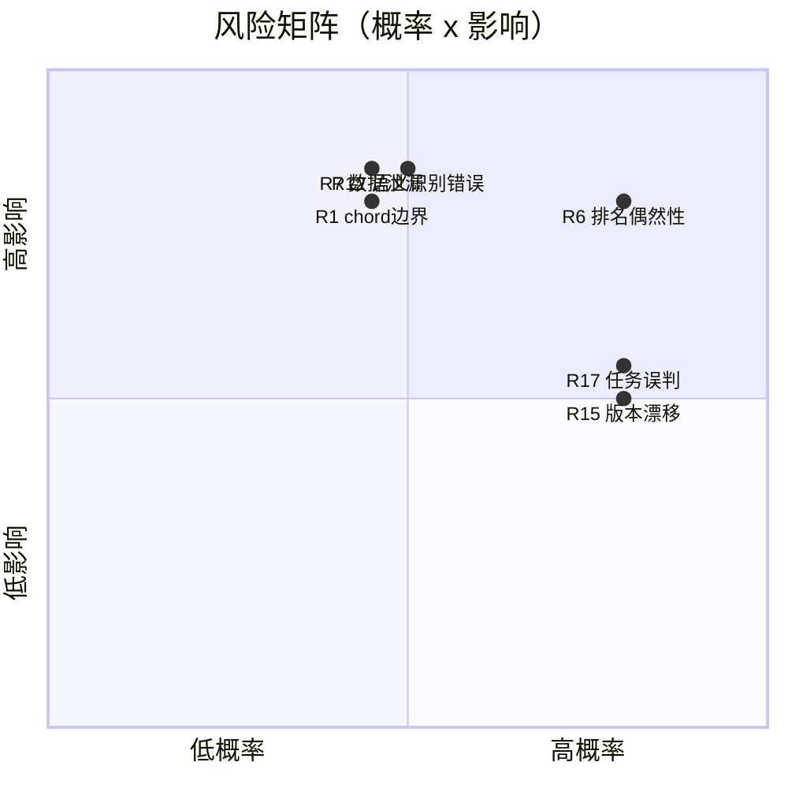

# 20. 风险分析（Risk Analysis）

| # | 类别 | 风险 | 概率 | 影响 | 缓解措施 | 应急预案 |
|---|---|---|---|---|---|---|
| R1 | 技术 | Celery chord 边界行为（部分失败/超时）导致回调不触发 | 中 | 高 | 集成测试 IT-05/07 覆盖；`task_acks_late`；janitor 巡检超时 RUNNING | 回调超时降级：janitor 检测到全部模型终态后手动触发 compare |
| R2 | 技术 | pycox/PyTorch 体积大、安装脆弱 | 高 | 中 | CPU 版 torch、镜像分层缓存；DeepSurv 设为可禁用插件 | 默认镜像不含 deepsurv，提供 `cdap-worker-full` 变体镜像 |
| R3 | 技术 | WeasyPrint 系统依赖与中文字体 | 中 | 中 | Linux 容器渲染；镜像内置 Noto Sans CJK | PDF 失败时仍可交付 HTML，报告状态 FAILED 可重试 |
| R4 | 技术 | scikit-survival GPL-3.0 许可 | 低 | 中 | 编码前 `pip-licenses` 评审；必要时独立 worker 进程隔离 | 替换为 lifelines AFT + sklearn GBM 组合实现（性能略降） |
| R5 | 技术 | 大文件内存爆掉 | 中 | 高 | 分块读取、异常值采样、worker 内存限制（K8s limits） | OOM 后任务 FAILED 并提示降低规模/升配 |
| R6 | 模型 | 单次划分导致排名偶然性 | 高 | 高 | 强制 5 折 CV，均值±std；排名规则含稳定性权重（09 章） | — |
| R7 | 模型 | 数据泄漏产生虚高指标 | 中 | 高 | 全部预处理 fit 限定 train fold；泄漏断言单测 | 金标准数据集回归比对，指标异常波动报警 |
| R8 | 模型 | 标签不平衡导致误导性 AUC | 中 | 中 | 校验 RV701 警告；自动补充 PR-AUC、class_weight 默认开启 | 报告「局限性」章节自动写入不平衡说明 |
| R9 | 模型 | 深度模型在小样本上过拟合 | 中 | 中 | DeepSurv 默认早停；报告披露训练/验证差距；过拟合迹象进入「不推荐原因」 | — |
| R10 | 医学 | 用户将报告用于临床决策 | 低 | 高 | 报告强制免责声明；UI 多处「科研用途」提示；平台定位文档明确 | 法律审查免责声明文本 |
| R11 | 医学 | 自动医学解释错误（模板化生成） | 中 | 高 | 解释章节标注「系统自动生成需核实」；仅基于统计事实模板化，不自由发挥 | 提供开关关闭医学解释章节 |
| R12 | 医学 | 列语义识别错误（如把住院天数当生存时间） | 中 | 高 | 置信度展示 + 用户确认环节（设计修正）+ 项目级词典可扩展 | 识别失败回退手动选择 |
| R13 | 医学/合规 | 患者隐私数据泄露 | 低 | 高 | 数据不出部署边界；无外部遥测；RBAC+项目隔离；审计日志；软删除+物理清除 | 安全事件响应流程；提供全量数据擦除工具 |
| R14 | 性能 | 12 模型 × 大样本超出单机能力 | 中 | 中 | 模型预计耗时展示；worker 水平扩展（compose scale / K8s HPA） | 引导用户分批模型或减少特征 |
| R15 | 维护 | 开源库版本漂移导致结果不可复现 | 高 | 中 | lock 文件 + 金标准回归（19 章 §5）；报告附版本快照 | 版本回滚镜像 tag |
| R16 | 维护 | 插件质量参差拖垮稳定性 | 中 | 中 | 插件启动校验、超时隔离、默认仅内置启用 | 一键禁用插件（管理页） |
| R17 | 需求 | 「全自动识别任务」误判引发用户不信任 | 高 | 中 | **设计修正：自动推荐 + 置信度 + 用户确认**（见 01 章 FR-4.3） | — |
| R18 | 项目 | 范围蔓延（FHIR/OMOP/AutoML 提前进入） | 中 | 中 | 版本边界文档化（00 章 §4）；新需求进 22 章 backlog | 变更需更新本蓝图并评审 |

## 风险看板（Top 5 重点跟踪）

