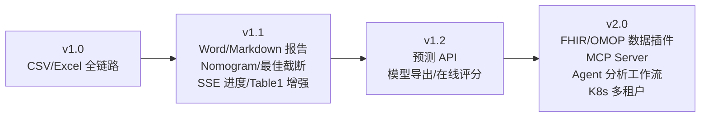

# 22. 未来扩展（Future Extensions）

## 1. 扩展路线图

## 2. 数据格式扩展（FHIR / OMOP / EHR）

| 扩展 | 方案 | 依赖的既有设计 |
|---|---|---|
| FHIR | 新增 `FormatAdapter` 插件（15 章 §3）：Bundle JSON → 资源展开（Patient/Observation/Condition）→ 宽表 | 插件点已预留；ehrapy 的 FHIR 导入设计可参考（16 章） |
| OMOP CDM | 直连 PG 的 OMOP schema，cohort 定义 → 宽表导出 | 存储抽象与 Dataset.source_type 已含 `omop` 枚举 |
| EHR 直连 | 医院视图/中间库 JDBC → 定时同步 | Dataset 版本化天然适配增量 |

**CSV/FHIR/OMOP 到平台标准字段的映射约定（草案）**

| 平台标准字段 | CSV 列名（词典例） | FHIR 路径 | OMOP 表.字段 |
|---|---|---|---|
| patient_id | patient_id/病案号/住院号 | Patient.id | person.person_id |
| age | age/年龄 | Patient.birthDate 推算 | person.year_of_birth 推算 |
| gender | gender/sex/性别 | Patient.gender | person.gender_concept_id |
| diagnosis | diagnosis/诊断 | Condition.code | condition_occurrence.condition_concept_id |
| lab:* | 化验列名（如 ALP/ALT） | Observation.code(LOINC)→value | measurement.measurement_concept_id→value_as_number |
| os_months | os/followup/随访时间 | 由 Encounter/日期推算 | 由 observation_period 推算 |
| event(death) | death/死亡/event | Patient.deceasedBoolean | death 表存在性 |

## 3. MCP / Agent / Workflow（对应 DVPlan 后期要求）

- **MCP Server**：把引擎层能力暴露为 MCP tools（`validate_dataset`、`run_analysis`、`get_comparison`、`generate_report`）。因引擎层与 FastAPI 解耦（02 章原则），MCP Server 只是第三个入口，预计 ≤ 3 人日。
- **Agent 工作流**：LLM Agent 调用 MCP tools 完成「自然语言 → 分析」：用户说「帮我比较这几个模型的生存预测效果」→ Agent 编排工具链。需增加：分析意图解析、结果自然语言摘要（受模板约束，防幻觉——复用 09 章理由模板引擎）。
- **Plugin 市场**：模型插件打包规范（pyproject entry_points）+ 签名验证 + 院内私有索引。

## 4. 模型与分析能力扩展

| 方向 | 内容 |
|---|---|
| 预测服务化 | run 完成后一键发布预测 API（加载 PreprocessSnapshot + 模型产物做 transform→predict）；Snapshot 设计已预留 |
| AutoML | flaml/autogluon 作为「元模型插件」接入现有注册表 |
| 外部验证 | 上传第二数据集对既有 run 做外部验证，报告追加外部验证章节 |
| 亚组/分层分析 | 按分期/性别分层自动重跑，森林图汇总 |
| Nomogram | Cox/logreg 列线图（借鉴 ClinicoPath，见 16 章） |

## 5. 平台化扩展

- 多租户：organization 表 + 行级隔离（现 RBAC 层扩展点）。
- SSO：OIDC 接入医院统一认证（core/security 抽象已留口）。
- 审计报表：audit_logs 可视化与导出（合规检查）。
- 国际化：前端与 README 双语见 T9.1–T9.3；后续按 T9.4（API 稳定码与控制流去中文化）→ T9.5（异步语言上下文与持久化动态内容）→ T9.6（HTML/PDF/Markdown/DOCX 多语言报告）推进，报告模板 key 已含语言维度。
